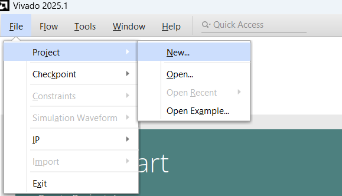
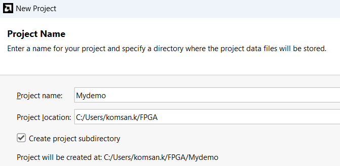

# Beginning with Xilinx Vivado

## Objectives

- Learn how to install and configure the Xilinx Vivado Design Suite.

- Create, simulate, and verify a basic Verilog project.

## 1. Introduction

Xilinx Vivado Design Suite is a powerful development environment for implementing digital systems on Xilinx FPGAs. It supports RTL design entry, simulation, synthesis, implementation, and bitstream generation for a wide range of Xilinx devices including Artix-7, Zynq-7000, and others. This section provides a step-by-step guide to installing Vivado, creating a new project, and verifying a basic Verilog design.

## 2. Installation

**System Requirements:**

- Operating System: Windows 10/11 (64-bit) or Ubuntu 20.04+

- RAM: Minimum 8 GB (16 GB recommended)

- Disk Space: At least 50 GB

**Installation Steps:**

1.  Go to <https://www.xilinx.com/support/download.html>.

2.  Navigate to `Products > Design Tools > Vivado Design Suite`

3.  Register an account and download the Vivado WebPACK edition

4.  Run the installer and select:

    - Vivado HL WebPACK

    - Device family support (e.g., Artix-7 for Nexys A7 board)

5.  Complete the installation and license activation

## 3. Creating a New Vivado Project

1.  Launch Vivado and select **Create Project**, as shown in Figure 1.

    

    *Figure 1. Creating a new project.*

2.  Enter project name and location, as demonstrated in Figure 2.

    

    *Figure 2. Completing file name and directory location.*

3.  Select **RTL Project** and enable `Do not specify sources at this time`

4.  Select the target FPGA device `xc7a100tcsg324-1`, as shown in Figure 3.

    

    *Figure 3. Specifying the target FPGA chip.*

5.  Finish project creation

## 4. Adding Design Sources

- Go to `Project Manager > Add Sources`

- Select `Add or Create Design Sources`, as shown in Figure 4.

- Select `Add or Create Simulation Sources`, as shown in Figure 5.

  

  *Figure 4. Adding a new design source.*

  

  *Figure 5. Adding a new testbench source.*

- Add files such as `and_gate.v`, `and_gate_tb.v`

**Example Verilog Module:**

```verilog
// Simple 2-input AND gate module
module and_gate(input A, input B, output Y); 
    assign Y = A & B; 
endmodule
```

## 5. Running Simulation

**Testbench:**

```verilog
module and_gate_tb;
    reg A, B;
    wire Y;
   // Instantiate the AND gate as Unit Under Test (UUT)
    and_gate uut (.A(A), .B(B), .Y(Y));
    initial begin
  // Apply all possible input combinations to test the AND gate
        A = 0; B = 0; #10;
        A = 0; B = 1; #10;
        A = 1; B = 0; #10;
        A = 1; B = 1; #10;
    end
endmodule
```

**Steps:**

- Select `Run Simulation > Run Behavioral Simulation`, as demonstrated in Figure 6.

- Use the waveform viewer to inspect outputs, as indicated in Figure 7.


*Figure 6. Start a simulation.*


*Figure 7. Waveform viewer.*

## 6. Tips and Troubleshooting

- Use `$display` and `$monitor` for testbench output

- Map I/O pins with an appropriate XDC constraint file

- Always check the `Messages` panel for warnings and errors

## 7. Conclusion

This section introduced the Vivado design environment and demonstrated how to create a new project, add Verilog files, run simulation, synthesize a design, and program an FPGA device. This foundation is essential for building more complex digital systems in subsequent labs.
