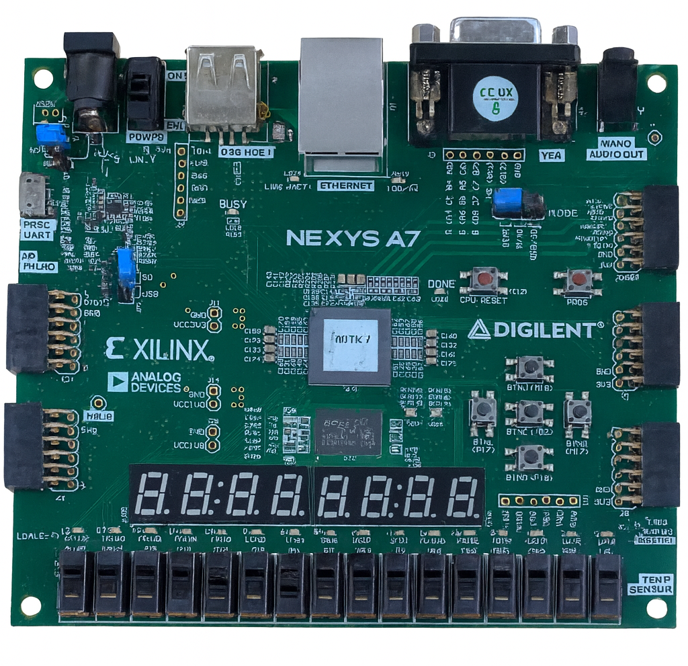
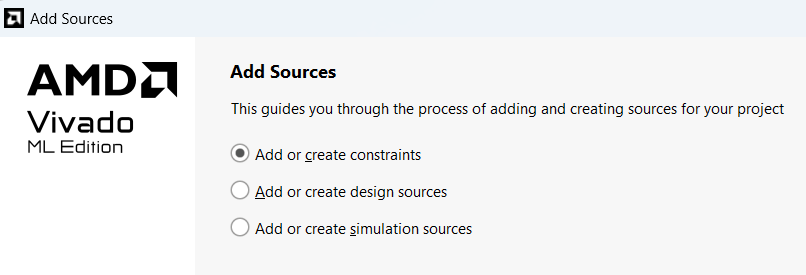
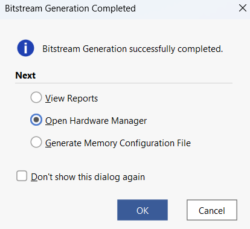
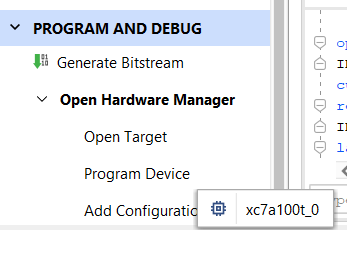
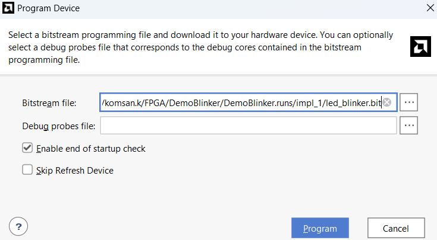

# Starting with Xilinx Nexys A7

The Xilinx Nexys A7 is an FPGA development board based on the Xilinx Artix-7 family. It is ideal for learning digital design using Verilog HDL and for prototyping embedded systems. This section guides you through setting up your development environment and preparing your first project.

## Objectives

- Set up the Nexys A7 FPGA board and configure Vivado for Artix-7 devices.

- Create a simple Verilog project to control onboard components.

- Use XDC constraints and program the FPGA with the generated bitstream.

## 1. Board Overview

Figure 1 illustrates the Nexys A7 FPGA development board, highlighting essential lab components such as 16 slide switches, 16 individual LEDs, and an 8-digit seven-segment display. Comprehensive documentation is available in the official Digilent reference manual, accessible at the [Digilent website](https://digilent.com/reference/programmable-logic/nexys-a7/).



*Figure 1. Nexys A7 Features.*

The Nexys A7 provides:

- Xilinx Artix-7 XC7A100T-1CSG324C FPGA

- 100 MHz system clock

- 16 user switches, 16 LEDs

- 7-segment display (Eight digits)

- VGA, USB-UART, and Pmod connectors

## 2. Required Software

Before you begin, install the following tools:

- **Xilinx Vivado Design Suite** (WebPACK edition is free)

- **Digilent Board Files** for Nexys A7 (optional for simplified setup)

- **USB drivers** (FTDI drivers may be required for UART interface)

## 3. Initial Setup Steps (similar to Lab 1)

1.  Connect the Nexys A7 to your computer using the micro-USB cable.

2.  Open Vivado and create a new RTL project with the following options:

    - Enable `Verilog` as the target language.

    - Set the part number to `xc7a100tcsg324-1`.

3.  Create source files and constraint files (.xdc) for your design.

## 4. Pin Mapping (Nexys A7)

The detial below lists common I/O components and their corresponding FPGA pin locations on the Nexys A7 board. These mappings should be defined in your constraints file (‘.xdc’) to connect Verilog ports to physical pins.

- **Clock and Reset:**

  - `clk`: `E3` (100 MHz onboard clock)

  - `rst`: `C12` (push button)

- **Slide Switches (`sw[15:0]`):**

  - `V10, U11, U12, H6, T13, R16, U8, T8, R13, U18, T18, R17, R15, M13, L16, J15`

- **LEDs (`led[15:0]`):**

  - `V11, V12, V14, V15, T16, U14, T15, V16, U16, U17, V17, R18, N14, J13, K15, H17`

- **Push Buttons (`btn[4:0]`):**

  - `N17, P18, M18, M17, P17`

- **7-Segment Display:**

  - `an[7:0]`: `U13, K2, T14, P14, J14, T9, J18, J17`

  - `seg[6:0]`: `L18, T11,P15, K13, K16, R10, T10`

  - `dp (decimal point)`: `H15`

- **UART (USB-to-Serial):**

  - `tx (FPGA to PC)`: `D4`

  - `rx (PC to FPGA)`: `C4`

- **Pmod Header JA (8 signals):**

  - `JA[0]`: `C17`

  - `JA[1]`: `D18`

  - `JA[2]`: `E18`

  - `JA[3]`: `G17`

  - `JA[4]`: `D17`

  - `JA[5]`: `E17`

  - `JA[6]`: `F18`

  - `JA[7]`: `G18`

- **Pmod Header JB (4 signals):**

  - `JB[0]`: `D14`

  - `JB[1]`: `F16`

  - `JB[2]`: `G16`

  - `JB[3]`: `H14`

  - `JB[4]`: `E16`

  - `JB[5]`: `F13`

  - `JB[6]`: `G13`

  - `JB[7]`: `H16`

- **VGA Output:**

  - `vga_red[3:0]`: `A4, C5, B4, A3`

  - `vga_green[3:0]`: `A6, B6, A5, C6`

  - `vga_blue[3:0]`: `D8, D7, C7, B7`

  - `vga_hsync`: `B11`, `vga_vsync`: `B12`

## 5. First Project: LED Blinker

As a starting project, create a simple Verilog module to blink an LED based on a divided clock. This verifies your toolchain, constraints, and programming workflow.

```verilog
module led_blinker ( // Toggles LED using the MSB of a counter
    input wire clk,
    output reg led
);
    reg [25:0] counter = 0;

    always @(posedge clk) begin
        counter <= counter + 1;   // Increment counter 
        led <= counter[25];       // LED toggles 
    end
endmodule
```

Connect ‘led’ to one of the onboard LEDs and ‘clk’ to pin ‘E3’.

## 6. Creating the XDC Constraints File for Nexys A7

To map Verilog HDL ports to physical FPGA pins on the Nexys A7 board, a constraints file (‘.xdc’) is required. This file specifies the pin locations and voltage standards for each I/O signal used in the design.

Below is a minimal example of a constraint file for a basic LED blinker project using the onboard 100 MHz clock and a single LED.

```tcl
## Clock signal
set_property PACKAGE_PIN E3 [get_ports clk]
set_property IOSTANDARD LVCMOS33 [get_ports clk]

## LED output (e.g., led[0])
set_property PACKAGE_PIN H17 [get_ports led]
set_property IOSTANDARD LVCMOS33 [get_ports led]

## Optional: Reset button
# set_property PACKAGE_PIN C12 [get_ports rst]
# set_property IOSTANDARD LVCMOS33 [get_ports rst]
```

Save the file as `led_blinker.xdc` and add it to your Vivado project using:

- **Flow Navigator** → `Add Sources` → `Add or Create Constraints`, as shown in Figure 2.




*Figure 2. Adding a new Constraints file.*

If you plan to use more LEDs or additional inputs, extend the constraint file accordingly by adding the appropriate pins listed in Table 1.


| **Component** | **Signal Name** | **FPGA Pin(s)**                        |
|:--------------|:----------------|:---------------------------------------|
| Clock         | clk             | E3                                     |
| Reset         | rst             | C12                                    |
| LEDs          | led\[7:0\]      | U16, U17, V17, R18, N14, J13, K15, H17 |

*Table 1. Nexys A7 I/O pin mapping summary.*


## 7. Programming the FPGA

1.  Synthesize the design in Vivado, as shown in Figure 3.

2.  Generate the bitstream, as shown in Figure 4.

3.  Open the Hardware Manager, as shown in Figure 5.

4.  Open Target to connect to the FPGA chip, as shown in Figure 6.

    

    *Figure 3. Performing design synthesis.*

    

    *Figure 4. Completing the Constraints file.*

    

    *Figure 5. Opening the hardware manager.*

    

    *Figure 6. Selecting the target device.*

    

    *Figure 7. Programming the device with the Bitstream file.*

5.  Program the device with the generated ‘.bit’ file, as shown in Figure 7.

Once programmed, the LED should blink at approximately 0.75 Hz (assuming a 100 MHz input clock).

## 8. Summary

You have now completed the initial steps to configure your environment and run a basic design on the Nexys A7 FPGA. From here, you can proceed to explore modules such as counters, multiplexers, FSMs, and UART transmitters.
