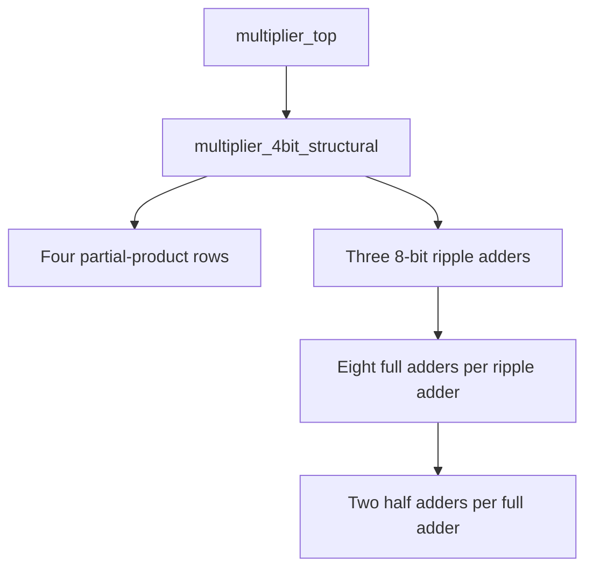

# Topic 10: Vivado-6 — Multiplier Study Case

## 1. Overview

Extend the hierarchical design approach of the supplied adder laboratory to an **unsigned 4-bit × 4-bit combinational multiplier**. Reuse half adders and full adders to construct an 8-bit ripple-carry adder, then combine shifted partial products to produce an 8-bit multiplication result.

The lab covers structural Verilog, exhaustive simulation, Vivado hierarchy inspection, FPGA implementation, and comparison with a multiplication-operator design.

## 2. Objectives

- Explain binary multiplication using partial products.
- Reuse lower-level modules in a hierarchical design.
- Implement an unsigned 4-bit multiplier with an 8-bit output.
- Verify every operand combination using a self-checking testbench.
- Connect operand switches and product LEDs on an FPGA board.
- Compare structural and inferred multiplier implementations using measured resource and timing reports.

## 3. Equipment and Prerequisites

| Resource | Purpose |
| --- | --- |
| Vivado Design Suite | RTL design, simulation, synthesis, and implementation |
| Basys 3, Nexys A7, or equivalent board | FPGA demonstration |
| Eight switches and eight LEDs | Operand entry and product display |
| USB programming cable | FPGA configuration |
| Official board constraints | Package pins and I/O standards |

Students should understand half adders, full adders, ripple-carry addition, module instantiation, and testbench basics. Record the exact board variant and Vivado version used. This lab requires neither MicroBlaze nor Vitis.

## 4. Binary Multiplication

For unsigned four-bit operands,

$$
A=\sum_{i=0}^{3}a_i2^i,\qquad B=\sum_{j=0}^{3}b_j2^j,
$$

the product is

$$
P=A B=\sum_{j=0}^{3}(A b_j)2^j.
$$

Each partial-product bit is generated by an AND operation. Four shifted partial-product rows are added to form the result.

| Row | Construction | Shift |
| --- | --- | ---: |
| `pp0` | `A` masked by `B[0]` | 0 |
| `pp1` | `A` masked by `B[1]` | 1 |
| `pp2` | `A` masked by `B[2]` | 2 |
| `pp3` | `A` masked by `B[3]` | 3 |

All shifted rows are explicitly extended to eight bits **before addition**. This avoids losing upper bits through an undersized intermediate signal.

### Output Width

Two unsigned N-bit operands require up to 2N product bits. For this design:

$$
0\leq A,B\leq15,\qquad P_{\max}=15\times15=225=11100001_2.
$$

An eight-bit output stores the complete result. There is no separate product carry output. This exercise is unsigned; signed two's-complement multiplication requires different operand declarations and structural treatment.

### Worked Example

For `A = 1011` (11) and `B = 0101` (5):

| Partial product | Eight-bit value | Decimal |
| --- | --- | ---: |
| `pp0` | `00001011` | 11 |
| `pp1` | `00000000` | 0 |
| `pp2` | `00101100` | 44 |
| `pp3` | `00000000` | 0 |
| Sum | `00110111` | 55 |

## 5. Design Hierarchy



The structural multiplier contains three cascaded 8-bit adders: first `pp0 + pp1`, then the intermediate sum plus `pp2`, and finally the next sum plus `pp3`. This is a straightforward educational shift-and-add combinational architecture, not a Wallace tree or a clocked sequential multiplier.

The RTL instantiates 24 full adders and 48 half adders. Synthesis may simplify constant inputs, optimize carry logic, or flatten hierarchy; these instance counts are not predicted FPGA resource counts.

## 6. Verilog Design Files

Save each module in the named `.v` file and add it as a **Design Source**.

### 6.1 `half_adder.v`

```verilog
module half_adder (
    input  wire A,
    input  wire B,
    output wire SUM,
    output wire CARRY
);
    assign SUM   = A ^ B;
    assign CARRY = A & B;
endmodule
```

### 6.2 `full_adder.v`

```verilog
module full_adder (
    input  wire A,
    input  wire B,
    input  wire CIN,
    output wire SUM,
    output wire COUT
);
    wire sum1, carry1, carry2;

    half_adder HA1 (
        .A(A), .B(B), .SUM(sum1), .CARRY(carry1)
    );
    half_adder HA2 (
        .A(sum1), .B(CIN), .SUM(SUM), .CARRY(carry2)
    );

    assign COUT = carry1 | carry2;
endmodule
```

### 6.3 `ripple_adder.v`

```verilog
module ripple_adder #(
    parameter integer N = 8
)(
    input  wire [N-1:0] A,
    input  wire [N-1:0] B,
    input  wire         CIN,
    output wire [N-1:0] SUM,
    output wire         COUT
);
    wire [N:0] carry;
    assign carry[0] = CIN;
    assign COUT = carry[N];

    genvar i;
    generate
        for (i = 0; i < N; i = i + 1) begin : ADDER_STAGE
            full_adder FA (
                .A(A[i]), .B(B[i]), .CIN(carry[i]),
                .SUM(SUM[i]), .COUT(carry[i+1])
            );
        end
    endgenerate
endmodule
```

Use a positive integer for `N`.

### 6.4 `multiplier_4bit_structural.v`

```verilog
module multiplier_4bit_structural (
    input  wire [3:0] A,
    input  wire [3:0] B,
    output wire [7:0] P
);
    wire [7:0] pp0, pp1, pp2, pp3;
    wire [7:0] sum01, sum012;
    wire carry01, carry012, carry_final;

    assign pp0 = {4'b0000, (A & {4{B[0]}})};
    assign pp1 = {3'b000,  (A & {4{B[1]}}), 1'b0};
    assign pp2 = {2'b00,   (A & {4{B[2]}}), 2'b00};
    assign pp3 = {1'b0,    (A & {4{B[3]}}), 3'b000};

    ripple_adder #(.N(8)) ADD0 (
        .A(pp0), .B(pp1), .CIN(1'b0),
        .SUM(sum01), .COUT(carry01)
    );
    ripple_adder #(.N(8)) ADD1 (
        .A(sum01), .B(pp2), .CIN(1'b0),
        .SUM(sum012), .COUT(carry012)
    );
    ripple_adder #(.N(8)) ADD2 (
        .A(sum012), .B(pp3), .CIN(1'b0),
        .SUM(P), .COUT(carry_final)
    );
endmodule
```

The maximum successive sums are 45, 105, and 225. Therefore, each sum fits within eight bits and all three carry-out signals are zero for valid binary operands. Their omission from the product output does not discard a significant product bit.

### 6.5 `multiplier_4bit_behavioral.v`

```verilog
module multiplier_4bit_behavioral (
    input  wire [3:0] A,
    input  wire [3:0] B,
    output wire [7:0] P
);
    assign P = A * B;
endmodule
```

The eight-bit assignment receives the full unsigned 4 × 4 product. Vivado may implement this multiplication using slice logic or DSP resources, depending on synthesis settings, operand size, and implementation goals. Inspect the reports rather than assuming a particular mapping.

### 6.6 `multiplier_top.v`

```verilog
module multiplier_top #(
    parameter integer USE_STRUCTURAL = 1
)(
    input  wire [7:0] SW,
    output wire [7:0] LED
);
    generate
        if (USE_STRUCTURAL != 0) begin : STRUCTURAL
            multiplier_4bit_structural MULT (
                .A(SW[3:0]), .B(SW[7:4]), .P(LED)
            );
        end else begin : BEHAVIORAL
            multiplier_4bit_behavioral MULT (
                .A(SW[3:0]), .B(SW[7:4]), .P(LED)
            );
        end
    endgenerate
endmodule
```

Set `USE_STRUCTURAL = 1` for the hierarchy exercise and `0` for the operator-based comparison. Only the selected branch is elaborated into hardware.

## 7. Exhaustive Self-Checking Testbench

Save the following as `tb_multiplier_4bit.sv` and add it as a **Simulation Source**. Select SystemVerilog as its file type and set `tb_multiplier_4bit` as the simulation top.

```systemverilog
`timescale 1ns / 1ps

module tb_multiplier_4bit;
    reg  [3:0] A, B;
    wire [7:0] P_structural, P_behavioral;
    reg  [7:0] expected;
    integer a_value, b_value;
    integer tests, errors;

    multiplier_4bit_structural DUT_S (
        .A(A), .B(B), .P(P_structural)
    );
    multiplier_4bit_behavioral DUT_B (
        .A(A), .B(B), .P(P_behavioral)
    );

    initial begin
        A = 0;
        B = 0;
        tests = 0;
        errors = 0;

        for (a_value = 0; a_value < 16; a_value = a_value + 1) begin
            for (b_value = 0; b_value < 16; b_value = b_value + 1) begin
                A = a_value[3:0];
                B = b_value[3:0];
                expected = a_value * b_value;
                #10;
                tests = tests + 1;

                if ((P_structural !== expected) ||
                    (P_behavioral !== expected)) begin
                    errors = errors + 1;
                    $display("FAIL: A=%0d B=%0d expected=%0d S=%0d B=%0d",
                             A, B, expected, P_structural, P_behavioral);
                end
            end
        end

        if (errors != 0)
            $fatal(1, "FAIL: %0d errors in %0d operand pairs", errors, tests);

        $display("PASS: both multipliers matched all %0d operand pairs", tests);
        $finish;
    end
endmodule
```

The reference expression multiplies loop integers and stores a result that is at most 225. Case inequality (`!==`) also detects unknown outputs. Run the simulation to completion; its test interval is 2,560 ns. The `#10` delay provides RTL settling time and is **not a measurement of physical propagation delay**.

Expected final message, to be confirmed by your simulator:

```text
PASS: both multipliers matched all 256 operand pairs
```

## 8. Vivado Project Procedure

### Step 1: Create the project

Create an RTL project named `topic10_multiplier`. Select the exact FPGA board or device and add the six design files from Section 6. Set `multiplier_top` as the synthesis top.

### Step 2: Inspect hierarchy

Open the elaborated design and schematic. Identify the multiplier instance, its partial products, the three ripple adders, and the full-adder/half-adder instances. Distinguish the elaborated RTL hierarchy from the optimized netlist produced by synthesis.

### Step 3: Run behavioral simulation

Add the SystemVerilog testbench, run behavioral simulation, and select **Run All**. Record the console summary and inspect `A`, `B`, `P_structural`, and `P_behavioral`. Expand `DUT_S` to inspect `pp0`–`pp3`, `sum01`, and `sum012` for a worked example.

### Step 4: Apply board constraints

Map the wrapper ports using the official XDC for your board variant:

| Port | Board resource | Meaning |
| --- | --- | --- |
| `SW[3:0]` | SW3–SW0 | Operand A, bit 3 to bit 0 |
| `SW[7:4]` | SW7–SW4 | Operand B, bit 3 to bit 0 |
| `LED[7:0]` | LED7–LED0 | Full eight-bit product |

Use the wrapper's exact uppercase port names in `get_ports`. Assign all package pins and I/O standards. Do not copy pin numbers between different boards. This switch-to-LED design has no clock or reset port.

### Step 5: Synthesize and implement

Run synthesis, inspect utilization and the synthesized schematic, then run implementation and generate the bitstream. Check warnings and constraints. Program the FPGA using Hardware Manager and test the cases below. Mechanical switch transitions can briefly produce intermediate outputs; assess the result after the switches settle.

## 9. Expected Results

| A | B | Product | LED7–LED0 |
| ---: | ---: | ---: | --- |
| 0 | 15 | 0 | `00000000` |
| 1 | 15 | 15 | `00001111` |
| 3 | 2 | 6 | `00000110` |
| 7 | 5 | 35 | `00100011` |
| 9 | 6 | 54 | `00110110` |
| 11 | 5 | 55 | `00110111` |
| 15 | 15 | 225 | `11100001` |

Complete a separate hardware record:

| A | B | Expected product | Observed LED pattern | Pass/Fail |
| ---: | ---: | ---: | --- | --- |
| 0 | 15 | 0 | | |
| 3 | 2 | 6 | | |
| 7 | 5 | 35 | | |
| 11 | 5 | 55 | | |
| 15 | 15 | 225 | | |

## 10. Structural versus Operator-Based Multiplication

| Aspect | Structural implementation | Operator-based implementation |
| --- | --- | --- |
| Description | AND partial products and explicit adders | `assign P = A * B;` |
| Teaching focus | Hierarchy and arithmetic data paths | Arithmetic inference and concise HDL |
| Optimization | Logic can be simplified or flattened | Synthesis chooses an arithmetic implementation |
| Resource use | Measure from the synthesized design | Measure from the synthesized design |
| Timing | Depends on optimized logic and routing | Depends on selected mapping and routing |

Create two synthesis/implementation runs with identical target device, I/O constraints, timing goals, and synthesis strategy. Change only `USE_STRUCTURAL`. Confirm that only the intended architecture remains in each run.

| Metric | Structural | Operator-based |
| --- | ---: | ---: |
| LUTs | | |
| Flip-flops | | |
| Carry primitives | | |
| DSP blocks | | |
| BRAM | | |
| User I/O | | |
| Worst constrained input-to-output path delay | | |

The RTL is combinational and contains no registers. Do not infer resource counts from source-code instance counts or assume the shorter HDL is automatically faster.

### Timing Interpretation

An unclocked switch-to-LED design has no register-to-register operating frequency. Do not report an Fmax from an unconstrained implementation or interpret the simulation's stimulus interval as a hardware speed limit.

For an educational input-to-output timing comparison, apply the same explicit maximum data-path delay to both runs, for example:

```tcl
# Educational 20 ns input-to-output data-path target.
# This is not an external interface timing specification or a clock.
set_max_delay -datapath_only 20.000 -from [all_inputs] -to [all_outputs]
```

Confirm the intended paths are constrained in the timing report and record data-path delay and slack. A clocked extension needs real clock constraints, setup/hold analysis, and defined input/output timing before an operating-frequency claim is meaningful.

### Optional DSP Mapping Exercise

Create separate versions of the operator-based module with a Vivado synthesis attribute:

```verilog
(* use_dsp = "yes" *)
module multiplier_4bit_behavioral (
    input  wire [3:0] A,
    input  wire [3:0] B,
    output wire [7:0] P
);
    assign P = A * B;
endmodule
```

Repeat with `use_dsp = "no"` for slice-logic implementation. Compile only one definition of this module in each run. Verify the actual mapping and tool messages; document the attribute and tool version. These attributes affect synthesis mapping, not the mathematical product.

## 11. Lab Tasks

1. Review or recreate the half-adder and full-adder modules from the adder lab.
2. Build the parameterized ripple adder and verify carry propagation with representative additions.
3. Construct the four shifted partial-product rows and manually check 11 × 5.
4. Instantiate three ripple adders to produce the product.
5. Implement the multiplication-operator version.
6. Run the exhaustive testbench and confirm all 256 operand pairs.
7. Inspect the elaborated hierarchy and optimized synthesized circuit.
8. Program the FPGA and complete the hardware results table.
9. Compare resource utilization and consistently constrained path delays.

## 12. Troubleshooting

| Symptom | Likely check |
| --- | --- |
| Module not found | Add all design sources and match module names exactly |
| Product loses upper bits | Eight-bit partial products, sums, and product port |
| Wrong result for 15 × 15 | Unsigned declarations, bit alignment, and carry wiring |
| Unknown simulation outputs | Undriven wires, incorrect port connections, or missing modules |
| `$fatal` not recognized | Testbench must be a SystemVerilog `.sv` simulation source |
| Testbench stops before summary | Run All or simulate longer than 2,560 ns |
| Simulation passes but LEDs are wrong | XDC mapping, board variant, bit order, and LED polarity |
| Hierarchy differs after synthesis | Optimization, constant propagation, and hierarchy flattening |
| No meaningful timing results | Missing path constraints; no clocked paths exist in the base design |

## 13. Discussion Questions

1. Why does a four-bit unsigned multiplier need an eight-bit output?
2. Why can AND gates generate partial products?
3. Why must rows be shifted according to multiplier-bit position?
4. Why are the partial products extended before addition?
5. Why are the three final carry-out signals always zero for valid operands?
6. How does hierarchy support reuse and verification?
7. Why might synthesized hardware differ from the drawn RTL hierarchy?
8. Why does the `*` operator not guarantee a specific LUT or DSP count?
9. How does this combinational design differ from a sequential shift-and-add multiplier?
10. Why is an unconstrained switch-to-LED design unsuitable for reporting Fmax?

## 14. Post-Lab Extensions

- **8 × 8 multiplier:** Generate eight 16-bit partial-product rows and add them using reusable modules. Verify all 65,536 operand pairs in simulation; adapt physical I/O because a direct full-width display needs more switches and LEDs.
- **Balanced adder tree:** Add `pp0 + pp1` and `pp2 + pp3` in parallel before the final addition. Compare measured timing rather than assuming a fixed improvement after synthesis.
- **Sequential multiplier:** Reuse one adder across multiple cycles. Define `start`, `busy`, `done`, reset behavior, and latency; compare area and throughput.
- **Registered multiplier:** Add input/output registers, a clock, and a valid signal. Define cycle timing and use a corresponding clocked scoreboard.
- **Signed multiplication:** Create a separate signed implementation and test positive/negative combinations. Do not reuse the unsigned partial-product equations unchanged.
- **Multiply-accumulate:** Extend the multiplier toward an ANN processing element. Select accumulator width and overflow behavior explicitly.

## 15. Submission Checklist

- All six design files and the self-checking testbench.
- Screenshot of the elaborated hierarchy and representative partial-product waveforms.
- Simulation console summary for all 256 operand pairs.
- Board pin-mapping record and hardware demonstration.
- Completed resource/timing comparison, with settings and constraints stated.
- Discussion answers and one optional extension.

## 16. References

1. Adapted from the supplied *Topic-9: Vivado-5 Hierarchy — Adder Study Case* (`README (15).md`).
2. AMD, [Vivado Design Suite User Guide: Synthesis (UG901)](https://docs.amd.com/r/en-US/ug901-vivado-synthesis), especially [Multipliers Implementation](https://docs.amd.com/r/en-US/ug901-vivado-synthesis/Multipliers-Implementation) and [USE_DSP](https://docs.amd.com/r/en-US/ug901-vivado-synthesis/USE_DSP).
3. AMD, [Vivado Design Suite User Guide: Logic Simulation (UG900)](https://docs.amd.com/r/en-US/ug900-vivado-logic-simulation).
4. AMD, [Vivado Design Suite User Guide: Using Constraints (UG903)](https://docs.amd.com/r/en-US/ug903-vivado-using-constraints).
5. Digilent, official reference manual and master XDC for the selected Basys 3 or Nexys A7 board.

**Key concept:** Reusable arithmetic modules can be assembled into a complete multiplier, while simulation and implementation reports establish its functional behavior and hardware characteristics.
