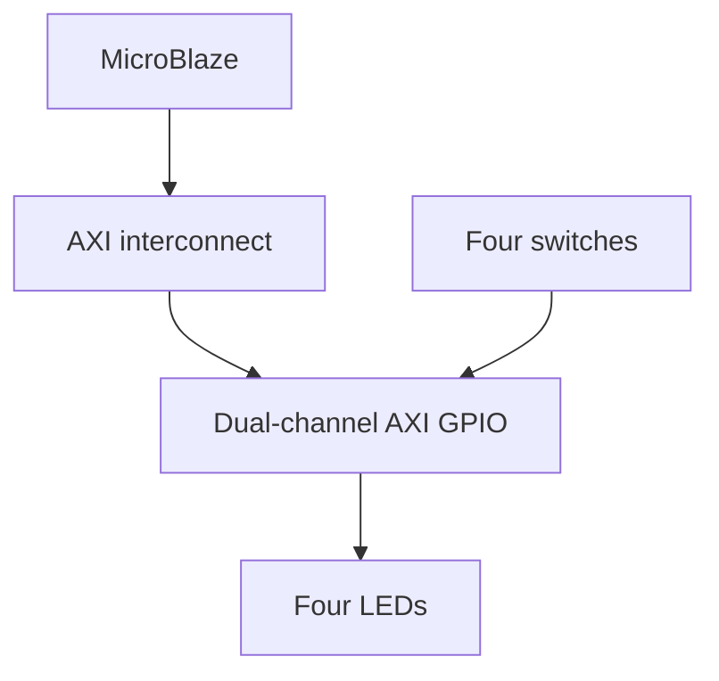

# 🔬 Topic-11: Vivado-7 IP Core-1 — AXI GPIO and AXI UARTLite


## 1. Overview

Build a MicroBlaze-based FPGA system that reads four switches and displays their states on four LEDs through AXI GPIO. This lab separates the GPIO material from the supplied combined GPIO/UARTLite laboratory. UART hardware is not required for the core exercise.

## 2. Objectives

- Explain reusable IP cores, memory-mapped I/O, and the role of an AXI interconnect.
- Create a MicroBlaze system in Vivado IP Integrator.
- Configure a dual-channel AXI GPIO peripheral.
- Export the hardware platform and develop a standalone C application.
- Verify GPIO behavior and record hardware resource utilization.

## 3. Equipment and Prerequisites

| Item | Purpose |
| --- | --- |
| Vivado and compatible Vitis installation | Hardware and embedded software development |
| Nexys A7, or an equivalent MicroBlaze-capable FPGA board | Implementation platform |
| USB programming cable | FPGA configuration and processor debugging |
| Four switches and four LEDs | Digital input and output |
| Official board constraints and reference manual | Clock, reset, and pin mapping |

Students should already understand combinational logic, registers, clocking, and basic C. Record the exact board variant and Vivado/Vitis versions used. The procedure describes the workflow; menu names can vary between releases.

## 4. Background

An IP core is a reusable hardware component. MicroBlaze executes embedded software, while AXI SmartConnect or AXI Interconnect routes memory-mapped transactions to peripherals. AXI GPIO provides an AXI4-Lite interface for digital I/O.

GPIO channels use data and direction registers. In the software direction mask, **1 means input and 0 means output**. This lab uses channel 1 for inputs and channel 2 for outputs.

| Setting | Channel 1 | Channel 2 |
| --- | --- | --- |
| Width | 4 bits | 4 bits |
| Hardware configuration | All inputs | All outputs |
| Board interface | SW3–SW0 | LED3–LED0 |
| Software direction mask | `0xF` | `0x0` |

For example, switch pattern `1011` represents decimal 11. Copying this value to the output channel displays the same four-bit pattern on the LEDs.

## 5. System Architecture



The processor also requires local instruction/data memory, a clock, synchronized resets, and a debug module. These support blocks are omitted from the simplified diagram.

## 6. Vivado Hardware Procedure

### Step 1: Create a project

1. Create an RTL project named `topic11_axi_gpio`.
2. Select the exact target board or FPGA part.
3. Create a block design named `system_gpio`.

### Step 2: Add MicroBlaze

1. Add the MicroBlaze IP.
2. Run Block Automation to configure local memory, debug support, clock/reset infrastructure, and a peripheral AXI master interface.
3. Ensure local memory is large enough for the application, stack, and heap. Check the application linker report after building.
4. Use the board clock configuration appropriate to the selected board. For Nexys A7, the onboard input clock is 100 MHz; an internal system frequency may be generated by the clocking infrastructure.

### Step 3: Configure AXI GPIO

1. Add one AXI GPIO instance, normally named `axi_gpio_0`.
2. Enable dual-channel operation.
3. Set channel 1 to four bits and all inputs.
4. Set channel 2 to four bits and all outputs.
5. Leave interrupts disabled for this polling exercise.

### Step 4: Connect buses, clocks, and resets

1. Run Connection Automation to connect GPIO `S_AXI` to the MicroBlaze peripheral bus through AXI SmartConnect or AXI Interconnect.
2. Connect the AXI clock and correctly synchronized reset signals.
3. Confirm the active-low peripheral reset is driven by the appropriate reset-controller output.
4. Assign a GPIO address segment in Address Editor and record its generated base address. Do not assume a fixed address.

### Step 5: Export and constrain GPIO

1. Make both GPIO channels external, or use the corresponding board interfaces.
2. Generate the HDL wrapper and inspect its actual port names.
3. Map input bits 0–3 to SW0–SW3 and output bits 0–3 to LED0–LED3.
4. Apply the clock, reset, package-pin, and I/O-standard constraints from the official constraints file for the exact board variant.
5. Confirm reset polarity and LED polarity against the board documentation.

External port names depend on interface configuration. Use the wrapper names rather than copying assumed names into the XDC file.

### Step 6: Build and export

1. Validate the block design and resolve errors.
2. Generate output products and update the wrapper if required.
3. Run synthesis, implementation, and bitstream generation.
4. Inspect timing, utilization, and unconstrained-port warnings.
5. Export an XSA hardware platform including the bitstream.

## 7. Vitis Software Procedure

1. Create a platform from the exported XSA.
2. Create a standalone MicroBlaze application using an empty C application template.
3. Inspect generated `xparameters.h` and the installed GPIO driver header.
4. Add the following code as `main.c` and build the application.
5. Program the FPGA, initialize the processor through the debugger, download the ELF, and run.

### Device-Identifier Compatibility

The code supports common legacy and System Device Tree (SDT) BSP conventions. Legacy initialization uses a device ID; SDT initialization uses a base address. If your instance has another name, adjust the matching macro below to the symbol generated in your BSP. Do not manually invent a device ID or substitute an address into a device-ID API.

### Complete GPIO Application

```c
#include "xgpio.h"
#include "xparameters.h"
#include "xstatus.h"

#ifdef SDT
# if defined(XPAR_XGPIO_0_BASEADDR)
#  define GPIO_IDENTIFIER XPAR_XGPIO_0_BASEADDR
# elif defined(XPAR_AXI_GPIO_0_BASEADDR)
#  define GPIO_IDENTIFIER XPAR_AXI_GPIO_0_BASEADDR
# else
#  error "Set GPIO_IDENTIFIER to the generated AXI GPIO base address."
# endif
#else
# if defined(XPAR_AXI_GPIO_0_DEVICE_ID)
#  define GPIO_IDENTIFIER XPAR_AXI_GPIO_0_DEVICE_ID
# elif defined(XPAR_GPIO_0_DEVICE_ID)
#  define GPIO_IDENTIFIER XPAR_GPIO_0_DEVICE_ID
# else
#  error "Set GPIO_IDENTIFIER to the generated AXI GPIO device ID."
# endif
#endif

#define SWITCH_CHANNEL 1U
#define LED_CHANNEL    2U
#define GPIO_MASK      0x0FU

int main(void)
{
    XGpio gpio;
    int status = XGpio_Initialize(&gpio, GPIO_IDENTIFIER);

    if (status != XST_SUCCESS) {
        /* Inspect status using the debugger; UART is not required. */
        return XST_FAILURE;
    }

    XGpio_SetDataDirection(&gpio, SWITCH_CHANNEL, GPIO_MASK);
    XGpio_SetDataDirection(&gpio, LED_CHANNEL, 0x00U);
    XGpio_DiscreteWrite(&gpio, LED_CHANNEL, 0x00U);

    while (1) {
        u32 switches = XGpio_DiscreteRead(&gpio, SWITCH_CHANNEL);
        XGpio_DiscreteWrite(&gpio, LED_CHANNEL, switches & GPIO_MASK);
    }
}
```

This is a polling application. It continuously reads GPIO rather than responding to interrupts. A debugger launch is required after configuration; generating a bitstream alone does not start this C program. The lab does not configure standalone boot from flash.

## 8. Experiments and Results

### Experiment A: Switch-to-LED Copy

Test all 16 switch combinations. Record at least the following cases, listing bits from bit 3 to bit 0.

| SW3–SW0 | Decimal value | Expected LED3–LED0 | Observed | Pass/Fail |
| --- | ---: | --- | --- | --- |
| `0000` | 0 | `0000` | | |
| `0001` | 1 | `0001` | | |
| `0101` | 5 | `0101` | | |
| `1010` | 10 | `1010` | | |
| `1111` | 15 | `1111` | | |

### Experiment B: Modify the Mapping

Change the output expression to each of the following and predict the results before programming:

```c
/* Invert the four switch bits. */
(~switches) & GPIO_MASK

/* Shift left by one position and retain four output bits. */
(switches << 1U) & GPIO_MASK
```

Use one expression at a time as the value passed to `XGpio_DiscreteWrite`.

### Experiment C: Resource Utilization

| Resource | MicroBlaze baseline, if available | Final GPIO design |
| --- | ---: | ---: |
| LUTs | | |
| Flip-flops | | |
| BRAM | | |
| DSP blocks | | |
| User I/O | | |

Record clock frequency and timing slack. Attribute resource differences to the complete changed design, including interconnect changes, rather than assuming every additional LUT belongs to GPIO.

## 9. Troubleshooting

| Symptom | Check |
| --- | --- |
| LEDs never change | Processor running, correct ELF/XSA pairing, GPIO channel configuration, clock/reset |
| Incorrect LED order | Bit ordering and XDC pin mapping |
| Initialization fails | Generated identifier and matching SDT/legacy driver API |
| Application cannot link | Local memory capacity and linker placement |
| Bitstream generation reports unconstrained ports | Wrapper names and complete clock/reset/I/O constraints |
| Unexpected button behavior in an extension | Input synchronization and mechanical debouncing |

GPIO reads alone do not establish that asynchronous external inputs are correctly synchronized. Inspect the configured hardware and add synchronizers or debouncing logic where needed; verify input-conditioning requirements before using buttons as event sources.

## 10. Discussion Questions

1. How does memory-mapped I/O differ from directly wiring switches to LEDs in HDL?
2. What does the AXI interconnect do?
3. Why does the direction mask use 1 for an input?
4. What is the difference between the bitstream and the application ELF?
5. Why must software use generated peripheral identifiers?
6. What are the advantages and costs of polling?

## 11. Extensions

- Expand the design to eight switches and eight LEDs.
- Add a second AXI GPIO peripheral for buttons.
- Add input conditioning and implement a button-controlled counter.
- Investigate GPIO interrupts as a separate advanced exercise.
- Continue to Topic 12 to report GPIO values or control LEDs through UART.

## 12. Submission Checklist

- Block-design screenshot showing GPIO channels, clock, and reset.
- Address-map and pin-mapping records.
- Application source and tool/BSP versions.
- Completed input/output and utilization tables.
- A short demonstration and answers to the discussion questions.

## 13. References

1. Adapted from the supplied combined lab, *Topic-11: Vivado-7 IP Core-1 — AXI GPIO and AXI UARTLite* (`README (13).md`).
2. AMD, [AXI GPIO Product Guide (PG144)](https://docs.amd.com/r/en-US/pg144-axi-gpio).
3. AMD, [Vivado IP Integrator User Guide (UG994)](https://docs.amd.com/r/en-US/ug994-vivado-ip-subsystems).
4. AMD, [GPIO driver API](https://xilinx.github.io/embeddedsw.github.io/gpio/doc/html/api/group__gpio__api.html) and [initialization source](https://github.com/Xilinx/embeddedsw/blob/master/XilinxProcessorIPLib/drivers/gpio/src/xgpio_sinit.c).
5. Digilent, [Nexys A7 Reference Manual](https://digilent.com/reference/programmable-logic/nexys-a7/reference-manual) and [Nexys A7-100T master XDC](https://github.com/Digilent/digilent-xdc/blob/master/Nexys-A7-100T-Master.xdc).

**Learning outcome:** Build and program a processor-based FPGA platform that reads physical inputs and controls physical outputs through AXI GPIO.


## 🧩 1. Objective

* Understand the concept of **Vivado IP cores** and reusable hardware blocks.
* Create an embedded FPGA system using **Vivado IP Integrator**.
* Configure and connect **AXI GPIO** and **AXI UARTLite** peripherals.
* Understand the role of the **AXI interconnect** in a processor-based FPGA system.
* Use GPIO for switch, button, and LED interfacing.
* Use UARTLite for serial communication between the FPGA system and a host computer.
* Generate a bitstream and export the hardware platform for software development.
* Perform basic peripheral access from an embedded processor such as **MicroBlaze**.
* Establish a foundation for later FPGA-SoC, sensor, IoT, and edge-computing laboratories.

---

## ⚙️ 2. Equipment and Tools

| Tool / Resource                                   | Description                            |
| ------------------------------------------------- | -------------------------------------- |
| **Vivado Design Suite**                           | FPGA hardware design and IP Integrator |
| **Vitis / Unified IDE**                           | Embedded software development          |
| **FPGA Board (Nexys A7 / Basys 3 or equivalent)** | Hardware implementation                |
| **MicroBlaze Processor**                          | Soft-core embedded processor           |
| **AXI GPIO IP Core**                              | General-purpose digital input/output   |
| **AXI UARTLite IP Core**                          | Lightweight UART serial interface      |
| **USB-UART Interface**                            | Serial communication with PC           |
| **Terminal Program**                              | PuTTY, Tera Term, minicom, etc.        |
| **LEDs / Switches / Buttons**                     | GPIO demonstration                     |

---

# 🧠 3. Background Theory

## 3.1 Vivado IP Cores

An **Intellectual Property (IP) core** is a pre-designed reusable hardware module.

Examples include:

* processors,
* memories,
* timers,
* UART controllers,
* GPIO controllers,
* Ethernet interfaces,
* SPI controllers,
* I²C controllers,
* DMA engines,
* DSP blocks.

Instead of manually implementing every hardware function in Verilog, Vivado allows designers to integrate verified IP blocks.

A system can therefore be constructed as

```text
Processor
   │
   ▼
AXI Interconnect
   │
   ├── AXI GPIO
   ├── AXI UARTLite
   ├── AXI Timer
   └── Other IP
```

This modular approach simplifies complex embedded FPGA development.

---

## 3.2 AXI Bus

AXI stands for

> **Advanced eXtensible Interface**

and is part of the AMBA architecture.

AXI is commonly used to connect processors and peripherals inside FPGA systems.

In this laboratory, the simplified communication model is

```text
MicroBlaze
    │
    ▼
AXI Interconnect
    │
    ├────► AXI GPIO
    │
    └────► AXI UARTLite
```

The processor accesses the peripherals through memory-mapped addresses.

Conceptually,

$$
\text{Peripheral Register}
\leftrightarrow
\text{Memory Address}.
$$

---

# 🏗️ 4. System Architecture

The target system is

```text
                 ┌─────────────────┐
                 │   MicroBlaze    │
                 └────────┬────────┘
                          │
                         AXI
                          │
                 ┌────────▼────────┐
                 │ AXI Interconnect│
                 └──────┬─────┬────┘
                        │     │
             ┌──────────┘     └──────────┐
             ▼                           ▼
      ┌─────────────┐             ┌─────────────┐
      │  AXI GPIO   │             │AXI UARTLite │
      └──────┬──────┘             └──────┬──────┘
             │                           │
      Switch / LED                 USB-UART / PC
```

The GPIO interface will be used for simple digital I/O, while UARTLite provides bidirectional serial communication.

---

# 🔌 5. AXI GPIO

## 5.1 Function

The AXI GPIO peripheral provides software-controlled digital I/O.

It can operate as:

* input,
* output,
* bidirectional GPIO,
* single-channel,
* dual-channel.

Examples include:

* reading switches,
* reading buttons,
* controlling LEDs,
* controlling external digital devices.

---

## 5.2 GPIO Data Representation

Suppose four FPGA switches are connected to

$$
GPIO[3:0].
$$

If the switch state is

```text
SW3 SW2 SW1 SW0
 1   0   1   1
```

the processor reads

$$
GPIO=1011_2=11.
$$

Similarly, writing

```text
0101
```

to an LED GPIO output activates selected LEDs.

---

# 💻 6. AXI GPIO Registers

The AXI GPIO peripheral provides memory-mapped registers.

Conceptually, the processor performs

$$
\text{Read GPIO Register}
$$

or

$$
\text{Write GPIO Register}.
$$

A simplified example is

```c
value = XGpio_DiscreteRead(&Gpio, 1);
```

for reading a GPIO channel, and

```c
XGpio_DiscreteWrite(&Gpio, 1, value);
```

for writing data.

The exact API depends on the BSP and software environment.

---

# 📡 7. UART Communication

## 7.1 UART Principle

UART stands for

> **Universal Asynchronous Receiver/Transmitter**

It provides asynchronous serial communication.

A typical UART frame consists of

```text
Idle | Start | Data Bits | Stop
 1      0      8 bits       1
```

For example,

```text
Start
  │
  ▼
0 D0 D1 D2 D3 D4 D5 D6 D7 1
```

No shared clock is transmitted between transmitter and receiver.

Both devices must use the same baud rate.

---

## 7.2 Common UART Parameters

Typical settings are

```text
Baud rate : 9600 or 115200
Data bits : 8
Parity    : None
Stop bits : 1
```

This configuration is commonly written as

```text
115200-8-N-1
```

---

# 📡 8. AXI UARTLite

AXI UARTLite is a compact UART peripheral designed for embedded FPGA systems.

It typically provides:

* transmit FIFO,
* receive FIFO,
* serial transmitter,
* serial receiver,
* status register,
* control register,
* AXI interface.

The communication path is

```text
MicroBlaze
    │
    ▼
AXI UARTLite
    │
    ▼
FPGA UART Pins
    │
    ▼
USB-UART Bridge
    │
    ▼
PC Terminal
```

---

# 🔁 9. Data Flow

## 9.1 GPIO Input Flow

```text
FPGA Switch
    │
    ▼
AXI GPIO
    │
    ▼
AXI Bus
    │
    ▼
MicroBlaze
```

---

## 9.2 GPIO Output Flow

```text
MicroBlaze
    │
    ▼
AXI GPIO
    │
    ▼
FPGA LED
```

---

## 9.3 UART Transmission Flow

```text
Software Character
      │
      ▼
MicroBlaze
      │
      ▼
AXI UARTLite
      │
      ▼
UART TX
      │
      ▼
PC Terminal
```

---

## 9.4 UART Reception Flow

```text
PC Keyboard
     │
     ▼
UART RX
     │
     ▼
AXI UARTLite
     │
     ▼
MicroBlaze
     │
     ▼
Application Software
```

---

# 🛠️ 10. Vivado Project Creation

## Step 1 — Create a New Project

Open Vivado and select

```text
Create Project
```

Choose

```text
RTL Project
```

and select the target FPGA board.

For example:

```text
Nexys A7
```

or another MicroBlaze-capable FPGA platform.

---

# 🧱 11. Create a Block Design

Select

```text
IP Integrator
    ↓
Create Block Design
```

Name the block design

```text
system
```

The IP Integrator canvas will open.

---

# 🧠 12. Add MicroBlaze

Select

```text
Add IP
```

and search for

```text
MicroBlaze
```

Add the MicroBlaze processor.

Vivado may display

```text
Run Block Automation
```

Select it to automatically configure:

* processor clock,
* local memory,
* reset,
* debug module,
* AXI interfaces.

The initial architecture becomes

```text
MicroBlaze
    │
    ├── Local Memory
    ├── Debug
    ├── Clock
    └── AXI Interface
```

---

# 🔌 13. Add AXI GPIO

Select

```text
Add IP
```

and search for

```text
AXI GPIO
```

Add the IP block.

Double-click the AXI GPIO block to configure it.

For this laboratory, use one possible configuration:

### GPIO Channel 1

```text
Width: 4 bits
Direction: Input
```

for switches.

### GPIO Channel 2

```text
Width: 4 bits
Direction: Output
```

for LEDs.

Enable

```text
Dual Channel
```

if both channels are implemented in one AXI GPIO core.

---

# 📡 14. Add AXI UARTLite

Select

```text
Add IP
```

and search for

```text
AXI UARTLite
```

Add it to the block design.

Configure the UART parameters.

Example:

```text
Baud Rate : 115200
Data Bits : 8
Parity    : None
```

The UARTLite peripheral will be connected to the processor through AXI.

---

# 🔗 15. Connect AXI Peripherals

Vivado can automatically connect AXI peripherals.

Select

```text
Run Connection Automation
```

The architecture should become similar to

```text
                  MicroBlaze
                       │
                       ▼
                AXI SmartConnect
                  /           \
                 /             \
                ▼               ▼
         AXI GPIO        AXI UARTLite
```

The SmartConnect or AXI interconnect handles processor-to-peripheral communication.

---

# ⏱️ 16. Clock and Reset

All synchronous system components require appropriate clock and reset signals.

The system may use a board clock such as

$$
100~\text{MHz}.
$$

The processor and AXI peripherals receive their clocks through the clocking infrastructure.

A simplified structure is

```text
Board Clock
    │
    ▼
Clock Wizard
    │
    ├── MicroBlaze
    ├── AXI GPIO
    └── AXI UARTLite
```

The reset subsystem distributes synchronized reset signals.

---

# 📌 17. Make GPIO External

For the GPIO interface, select the GPIO ports and choose

```text
Make External
```

The design may show ports such as

```text
gpio_rtl_tri_i[3:0]
gpio2_rtl_tri_o[3:0]
```

depending on the configuration.

These external ports will later be mapped to FPGA switches and LEDs.

---

# 📌 18. Make UART External

Select the UARTLite interface and choose

```text
Make External
```

The external signals typically include

```text
uart_rtl_rxd
uart_rtl_txd
```

They should be connected to the FPGA board's USB-UART interface pins.

---

# 🗺️ 19. Address Assignment

Select

```text
Address Editor
```

Vivado assigns memory addresses to the AXI peripherals.

For example, the system may conceptually contain

| Peripheral   | Address Region        |
| ------------ | --------------------- |
| AXI GPIO     | Memory-mapped address |
| AXI UARTLite | Memory-mapped address |

The actual base addresses are generated by Vivado and should be obtained from the platform configuration rather than assumed manually.

The processor communicates with peripherals using

$$
\text{Read/Write}
\rightarrow
\text{Peripheral Address}.
$$

---

# ✅ 20. Validate the Design

Select

```text
Tools
    ↓
Validate Design
```

or

```text
Validate Design
```

from the block design toolbar.

Vivado checks:

* AXI connectivity,
* clock connections,
* reset connections,
* interface consistency.

Correct all reported errors before continuing.

---

# 📦 21. Generate HDL Wrapper

From the Sources window:

1. Right-click the block design.
2. Select

```text
Create HDL Wrapper
```

3. Choose

```text
Let Vivado manage wrapper and auto-update
```

The generated wrapper becomes the FPGA top-level design.

---

# 🧷 22. FPGA Constraints

GPIO and UART external ports must be mapped to physical board pins using an XDC file.

A conceptual mapping is

| FPGA Signal       | Board Resource |
| ----------------- | -------------- |
| GPIO input bit 0  | SW0            |
| GPIO input bit 1  | SW1            |
| GPIO input bit 2  | SW2            |
| GPIO input bit 3  | SW3            |
| GPIO output bit 0 | LED0           |
| GPIO output bit 1 | LED1           |
| GPIO output bit 2 | LED2           |
| GPIO output bit 3 | LED3           |
| UART RX           | USB-UART TX    |
| UART TX           | USB-UART RX    |

Use the official XDC file for the selected board.

---

# 🔨 23. Generate the Bitstream

Run

```text
Run Synthesis
    ↓
Run Implementation
    ↓
Generate Bitstream
```

After successful implementation, inspect:

* timing,
* utilization,
* warnings,
* I/O assignment.

---

# 📊 24. FPGA Resource Analysis

Record the synthesis results.

| FPGA Resource | Utilization |
| ------------- | ----------: |
| LUTs          |             |
| Flip-Flops    |             |
| BRAM          |             |
| DSP           |             |
| I/O           |             |

Discuss which resources are associated with:

* MicroBlaze,
* AXI interconnect,
* GPIO,
* UARTLite.

---

# 📦 25. Export Hardware Platform

After generating the bitstream, export the hardware platform.

Typical flow:

```text
File / Export
      ↓
Export Hardware
      ↓
Include Bitstream
```

In current Vivado workflows, this normally generates an

```text
.xsa
```

hardware platform file.

This file is used by the embedded software development environment.

---

# 💻 26. Create Embedded Software Project

Open Vitis or the applicable AMD embedded development environment.

Create a platform based on the exported hardware.

Then create an application project.

A simple application will:

1. initialize GPIO,
2. initialize UARTLite,
3. read switches,
4. write LEDs,
5. send status messages to the terminal.

---

# 🧠 27. GPIO Software Concept

A basic GPIO program follows

```text
Initialize GPIO
      │
      ▼
Set Input Direction
      │
      ▼
Set Output Direction
      │
      ▼
Read Switches
      │
      ▼
Write LEDs
```

The application can implement

$$
LED=SWITCH.
$$

Thus, the processor reads a value from one GPIO channel and writes it to another.

---

# 💻 28. Example GPIO Application

A conceptual C implementation is

```c
#include "xgpio.h"
#include "xparameters.h"

int main()
{
    XGpio Gpio;

    unsigned int value;

    XGpio_Initialize(
        &Gpio,
        XPAR_AXI_GPIO_0_DEVICE_ID
    );

    XGpio_SetDataDirection(
        &Gpio,
        1,
        0xF
    );

    XGpio_SetDataDirection(
        &Gpio,
        2,
        0x0
    );

    while (1)
    {
        value =
            XGpio_DiscreteRead(
                &Gpio,
                1
            );

        XGpio_DiscreteWrite(
            &Gpio,
            2,
            value
        );
    }

    return 0;
}
```

The symbolic identifiers can differ between Vivado/Vitis versions and BSP configurations, so students should verify the generated `xparameters.h`.

---

# 📡 29. UARTLite Software Concept

The UART application performs

```text
Initialize UARTLite
        │
        ▼
Send Character/String
        │
        ▼
Wait for Received Data
        │
        ▼
Read Character
        │
        ▼
Process / Echo Data
```

---

# 💻 30. UARTLite Echo Example

A simple echo application concept is

```c
#include "xuartlite.h"
#include "xparameters.h"

int main()
{
    XUartLite Uart;

    unsigned char rx;
    unsigned int received;

    XUartLite_Initialize(
        &Uart,
        XPAR_AXI_UARTLITE_0_DEVICE_ID
    );

    while (1)
    {
        received =
            XUartLite_Recv(
                &Uart,
                &rx,
                1
            );

        if (received == 1)
        {
            XUartLite_Send(
                &Uart,
                &rx,
                1
            );
        }
    }

    return 0;
}
```

When a user presses a key in the PC terminal, the FPGA returns the same character.

This is called

$$
\boxed{\text{UART Echo}}.
$$

---

# 🧪 31. Combined GPIO and UART Application

The next experiment combines both peripherals.

The system behavior is

```text
Read Switches
      │
      ├────────► LEDs
      │
      └────────► UART Message
```

The processor periodically reads the switch state and reports it through UART.

For example,

```text
Switch value = 3
```

or

```text
GPIO = 0x0A
```

may appear in the serial terminal.

---

# 💻 32. Example Combined Application

```c
#include "xgpio.h"
#include "xuartlite.h"
#include "xparameters.h"
#include <stdio.h>

int main()
{
    XGpio Gpio;
    XUartLite Uart;

    unsigned int switches;
    char buffer[32];

    XGpio_Initialize(
        &Gpio,
        XPAR_AXI_GPIO_0_DEVICE_ID
    );

    XUartLite_Initialize(
        &Uart,
        XPAR_AXI_UARTLITE_0_DEVICE_ID
    );

    XGpio_SetDataDirection(
        &Gpio,
        1,
        0xF
    );

    XGpio_SetDataDirection(
        &Gpio,
        2,
        0x0
    );

    while (1)
    {
        switches =
            XGpio_DiscreteRead(
                &Gpio,
                1
            );

        XGpio_DiscreteWrite(
            &Gpio,
            2,
            switches
        );

        sprintf(
            buffer,
            "Switch = %u\r\n",
            switches
        );

        XUartLite_Send(
            &Uart,
            (unsigned char *)buffer,
            strlen(buffer)
        );

        for (volatile int i = 0;
             i < 1000000;
             i++);
    }

    return 0;
}
```

Add the required standard headers for the exact compiler/toolchain configuration.

---

# 📊 33. Expected Hardware Behavior

Suppose

```text
SW3 SW2 SW1 SW0
 0   1   0   1
```

Then

$$
SWITCH=0101_2=5.
$$

The processor reads

$$
5
$$

and writes

```text
LED3 LED2 LED1 LED0
 0    1    0    1
```

The terminal may display

```text
Switch = 5
```

Therefore, one experiment demonstrates both

$$
\boxed{\text{GPIO I/O}}
$$

and

$$
\boxed{\text{Serial Communication}}.
$$

---

# 🔁 34. UART-Controlled LEDs

A useful extension is to control LEDs through UART commands.

For example:

```text
PC sends '0' → LEDs OFF
PC sends '1' → LED0 ON
PC sends '2' → LED1 ON
PC sends 'A' → All LEDs ON
```

The data path becomes

```text
PC Terminal
    │
    ▼
UARTLite
    │
    ▼
MicroBlaze
    │
    ▼
AXI GPIO
    │
    ▼
LEDs
```

This illustrates software-controlled physical I/O.

---

# 🧠 35. Polling versus Interrupts

The simple applications in this laboratory use **polling**.

Polling repeatedly checks

```text
Is new UART data available?
```

or

```text
What is the current GPIO state?
```

A more advanced system can use interrupts.

```text
Peripheral Event
      │
      ▼
Interrupt Controller
      │
      ▼
MicroBlaze
      │
      ▼
Interrupt Service Routine
```

Interrupt-driven designs reduce unnecessary processor polling and are introduced in later laboratories.

---

# 🆚 36. Custom Verilog versus IP Core

| Characteristic           | Custom HDL         | Vivado IP Core |
| ------------------------ | ------------------ | -------------- |
| Development time         | Longer             | Shorter        |
| Flexibility              | Very high          | Configurable   |
| Verification effort      | High               | Reduced        |
| AXI support              | Must be designed   | Built in       |
| Reusability              | Designer-dependent | High           |
| Embedded integration     | More complex       | Easier         |
| Learning low-level logic | Excellent          | Moderate       |
| System integration       | Moderate           | Excellent      |

IP cores are especially useful when constructing larger embedded systems.

---

# 🧱 37. Hardware/Software Co-Design

This laboratory introduces **hardware/software co-design**.

The hardware platform contains

```text
MicroBlaze
AXI Bus
GPIO
UARTLite
Memory
Clock
Reset
```

while the software determines system behavior.

Thus,

$$
\boxed{
\text{FPGA Hardware}
+
\text{Embedded Software}
= \text{Embedded System}
}
$$

---

# 🧪 38. Lab Tasks

### Task 1 — Create MicroBlaze System

Build a MicroBlaze processor system using Vivado IP Integrator.

### Task 2 — Add AXI GPIO

Configure a GPIO peripheral with:

* 4-bit input,
* 4-bit output.

### Task 3 — Add AXI UARTLite

Configure UARTLite for serial communication.

### Task 4 — Connect AXI Interfaces

Use connection automation to connect both peripherals to MicroBlaze.

### Task 5 — External Interfaces

Connect:

* switches,
* LEDs,
* UART RX,
* UART TX.

### Task 6 — Validate Design

Verify the block design with Vivado.

### Task 7 — Generate Bitstream

Synthesize, implement, and generate the FPGA bitstream.

### Task 8 — GPIO Software

Create an application that copies

$$
Switches\rightarrow LEDs.
$$

### Task 9 — UART Echo

Create an application that receives and retransmits UART characters.

### Task 10 — Combined Experiment

Read switches, display the value on LEDs, and transmit the value through UART.

---

# 📋 39. Experimental Results

Students should complete the following table.

| Experiment  | Input         | Expected Output    | Measured Output | Pass/Fail |
| ----------- | ------------- | ------------------ | --------------- | --------- |
| GPIO Test 1 | `0000`        | LEDs `0000`        |                 |           |
| GPIO Test 2 | `0001`        | LEDs `0001`        |                 |           |
| GPIO Test 3 | `0101`        | LEDs `0101`        |                 |           |
| GPIO Test 4 | `1111`        | LEDs `1111`        |                 |           |
| UART TX     | Test string   | PC receives string |                 |           |
| UART RX     | Character `A` | FPGA receives `A`  |                 |           |
| UART Echo   | Character `B` | PC receives `B`    |                 |           |

---

# 📈 40. Resource Utilization Study

Record the hardware utilization.

| Resource   | MicroBlaze System | Final Design |
| ---------- | ----------------: | -----------: |
| LUTs       |                   |              |
| Flip-Flops |                   |              |
| BRAM       |                   |              |
| DSP        |                   |              |
| I/O        |                   |              |

Discuss the hardware cost of adding:

* AXI GPIO,
* UARTLite,
* interconnect logic.

---

# 💬 41. Discussion Points

1. What is a Vivado IP core?
2. Why are IP cores useful in FPGA system design?
3. What is AXI?
4. What is the role of AXI SmartConnect or AXI Interconnect?
5. What is memory-mapped I/O?
6. What is the purpose of AXI GPIO?
7. What is the purpose of AXI UARTLite?
8. Why must UART transmitter and receiver use compatible baud rates?
9. What is the difference between UART TX and RX?
10. What is the difference between hardware design and embedded software design?
11. What is the difference between polling and interrupt-driven communication?
12. Why should software use generated device definitions rather than assuming peripheral addresses?

---

# 🧠 42. Post-Lab Exercises

1. **Eight-Bit GPIO**
   Expand the GPIO from 4 bits to 8 bits.

2. **Button Input**
   Add push buttons as another GPIO input.

3. **UART Command Interface**
   Implement commands such as

   ```text
   LED ON
   LED OFF
   READ SW
   ```

4. **ASCII-to-LED Control**
   Use characters `0` to `F` to control four LEDs.

5. **UART GPIO Monitor**
   Continuously report switch changes through UART.

6. **Second AXI GPIO Core**
   Add another AXI GPIO peripheral.

7. **Interrupt-Based UART**
   Add interrupt support for UART reception.

8. **Interrupt-Based GPIO**
   Generate an interrupt when a button is pressed.

9. **AXI Timer**
   Add an AXI Timer to create periodic events.

10. **Sensor Interface**
    Connect an external sensor and transmit the measured data over UART.

---

# 🚀 43. Advanced Exercise — UART Command Processor

Create a basic command interface.

Example terminal interaction:

```text
> led 5
LED pattern = 0101

> read
Switch value = 9

> allon
LED pattern = 1111

> alloff
LED pattern = 0000
```

The system architecture is

```text
PC Terminal
     │
     ▼
AXI UARTLite
     │
     ▼
Command Parser
     │
     ▼
MicroBlaze
     │
     ▼
AXI GPIO
     │
     ▼
FPGA LEDs
```

This transforms the FPGA system into a simple interactive embedded controller.

---

# 🌐 44. Extension to IoT and Embedded Systems

UART and GPIO are basic interfaces that can later connect the FPGA to:

* ESP32,
* Arduino,
* Raspberry Pi,
* Wi-Fi modules,
* Bluetooth modules,
* sensor controllers.

For example,

```text
FPGA
 │
 ├── GPIO ─────► Sensors / Actuators
 │
 └── UART ─────► ESP32
                    │
                    ▼
                 Wi-Fi
                    │
                    ▼
                 Cloud
```

Thus, this laboratory provides an initial bridge between FPGA logic and connected embedded systems.

---

# 🔗 45. Extension to AI-FPGA Systems

The same architecture can support AI accelerators.

```text
MicroBlaze
    │
    ▼
AXI Bus
    │
    ├── AXI GPIO
    ├── AXI UARTLite
    └── Custom AI Accelerator
              │
              ▼
          ANN / CNN / MAC
```

UART can provide input data or debugging messages, while GPIO can visualize AI classification results.

This creates the basis for

$$
\boxed{
\text{Processor}
+
\text{AXI}
+
\text{AI Accelerator}
}
$$

architectures.

---

# 🧾 46. Expected Learning Outcomes

After completing this laboratory, students will be able to:

* Explain the concept of Vivado IP cores.
* Describe the AXI interconnect architecture.
* Create a MicroBlaze-based block design.
* Configure AXI GPIO.
* Configure AXI UARTLite.
* Connect AXI peripherals using IP Integrator.
* Assign external GPIO and UART interfaces.
* Generate and implement an FPGA hardware platform.
* Access GPIO peripherals from embedded software.
* Transmit and receive data using UARTLite.
* Understand memory-mapped peripheral access.
* Develop a simple hardware/software co-design system.
* Establish a foundation for more advanced FPGA embedded systems.

---

# 📘 47. References

1. AMD Xilinx, *Vivado Design Suite User Guide: Designing IP Subsystems Using IP Integrator*.
2. AMD Xilinx, *MicroBlaze Processor Reference Guide*.
3. AMD Xilinx, *AXI GPIO Product Guide*.
4. AMD Xilinx, *AXI UARTLite Product Guide*.
5. ARM, *AMBA AXI and ACE Protocol Specification*.
6. M. D. Ciletti, *Advanced Digital Design with the Verilog HDL*, Pearson.
7. S. Brown and Z. Vranesic, *Fundamentals of Digital Logic with Verilog Design*, McGraw-Hill.

---

## 🔑 Key Concept

The key hardware structure studied in this laboratory is

$$
\boxed{
\text{MicroBlaze}
\rightarrow
\text{AXI Interconnect}
\rightarrow
\text{AXI Peripherals}
}
$$

with

$$
\boxed{
\text{AXI GPIO}
\rightarrow
\text{Physical Digital I/O}
}
$$

and

$$
\boxed{
\text{AXI UARTLite}
\rightarrow
\text{Serial Communication}
}
$$

The complete embedded FPGA system can therefore be summarized as

$$
\boxed{
\text{Processor}
+
\text{AXI Bus}
+
\text{GPIO}
+
\text{UART}
+
\text{Embedded Software}
}
$$

This laboratory provides the foundation for subsequent work involving **AXI Timer, interrupts, SPI, I²C, custom AXI peripherals, DMA, sensor interfacing, IoT gateways, and AI-FPGA accelerators**.
