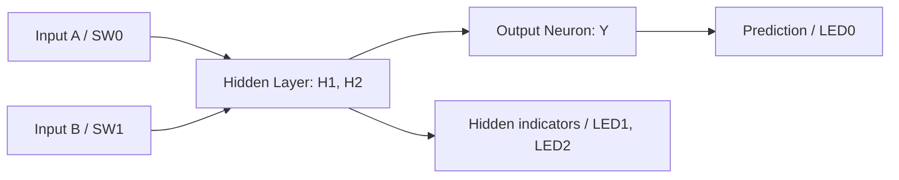
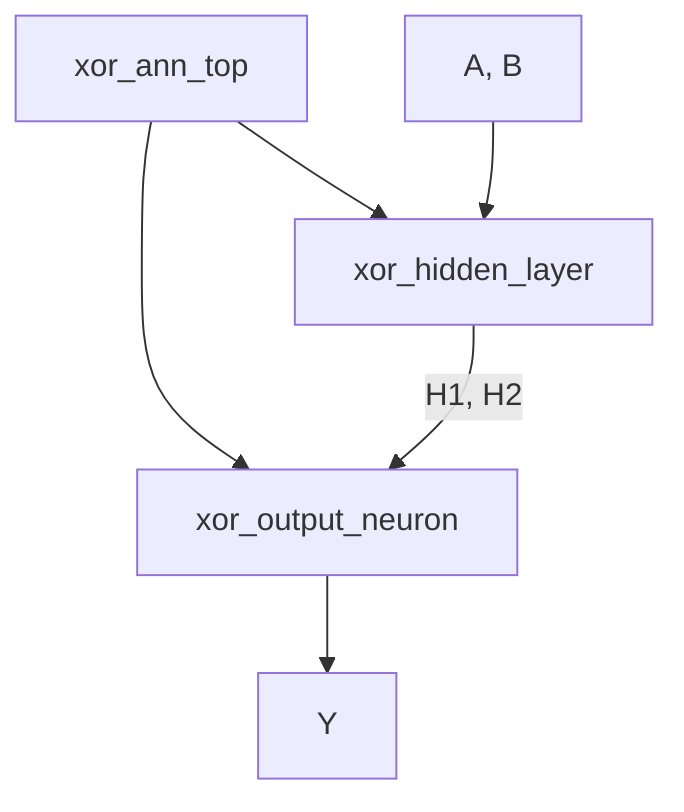

# Topic-13: AI-FPGA — Artificial Neural Network for XOR Function

## Laboratory Worksheet and Report Template

**Course:** 977-220 FPGA  

**Student name:** ______________________________  
**Student ID:** ________________________________  
**Group:** _____________________________________  
**Date:** ______________________________________

> **Instructions:** Complete each task and fill in the observation tables. Attach circuit diagrams, Verilog source files, simulation screenshots, FPGA photographs, and Vivado utilization reports where requested. The ANN weights are provided; **this laboratory performs FPGA inference, not on-board ANN training**.

---

## 1. Learning Objectives

After this laboratory, students should be able to:

1. Explain why XOR is not linearly separable by a single perceptron.
2. Describe a **2-input → 2-hidden-neuron → 1-output-neuron** ANN.
3. Calculate weighted sums, biases, and step-function activations.
4. Implement a hierarchical ANN using Verilog HDL.
5. Verify all four XOR cases in Vivado XSim.
6. Implement the ANN on a Nexys A7 using switches and LEDs.
7. Interpret FPGA resource utilization and distinguish training from inference.

## 2. Required Equipment

- Nexys A7 FPGA board, USB cable, and computer
- AMD Vivado with XSim
- Verilog modules and testbench from the Topic-13 teaching material
- FPGA switches **SW0**, **SW1** and LEDs **LED0**, **LED1**, **LED2**

## 3. Background and System Architecture

The XOR truth table is:

| A | B | Expected XOR (Y) |
|:---:|:---:|:---:|
| 0 | 0 | 0 |
| 0 | 1 | 1 |
| 1 | 0 | 1 |
| 1 | 1 | 0 |

The hidden layer implements OR and NAND through weighted sums and a step activation; the output neuron combines their activations to reproduce XOR.



**Figure 1.** System-level architecture of the 2–2–1 ANN inference engine.

The activation function is:

\[
f(z)=\begin{cases}1,&z>0\\0,&z\leq0\end{cases}
\]

Use the **integer-scaled** neuron equations from the source material:

\[
\begin{aligned}
z_1 &= 2A+2B-1, & H_1&=f(z_1),\\
z_2 &=-2A-2B+3, & H_2&=f(z_2),\\
z_o &=2H_1+2H_2-3, & Y&=f(z_o).
\end{aligned}
\]

**Question:** Why is a hidden layer required for a conventional feedforward ANN to represent XOR?

**Answer:** __________________________________________________________________

______________________________________________________________________________

---

## 4. Task 1 — Manual ANN Calculation

Calculate the weighted sum and activation of each neuron for **all four input combinations**. Use the equations in Section 3.

| A | B | z1 | H1 | z2 | H2 | zo | ANN Y | Expected XOR | Match? |
|:---:|:---:|:---:|:---:|:---:|:---:|:---:|:---:|:---:|:---:|
| 0 | 0 | | | | | | | 0 | |
| 0 | 1 | | | | | | | 1 | |
| 1 | 0 | | | | | | | 1 | |
| 1 | 1 | | | | | | | 0 | |

**Show one worked example** (select one input combination):

- Input (A, B) = (____, ____)
- Hidden neuron 1: z1 = __________________ ; H1 = ____
- Hidden neuron 2: z2 = __________________ ; H2 = ____
- Output neuron: zo = ___________________ ; Y = ____

**Observation:** ______________________________________________________________

---

## 5. Task 2 — Hierarchical Verilog Implementation

Create a Vivado project and implement the following modules from the Topic-13 teaching material.

| File / module | Function | Completed? |
|---|---|:---:|
| `xor_hidden_layer.v` | Calculate H1 and H2 using integer weighted sums | ☐ |
| `xor_output_neuron.v` | Calculate Y from H1 and H2 | ☐ |
| `xor_ann_top.v` | Instantiate the hidden and output layers | ☐ |
| `tb_xor_ann.v` | Apply all four input combinations | ☐ |

### Hierarchical RTL structure



**Figure 2.** Hierarchical Verilog module interconnection.

**Implementation checklist:**

- [ ] Use signed arithmetic for the weighted sums.
- [ ] Use the threshold **greater than zero**, not greater than or equal to zero.
- [ ] Connect the hidden outputs `H1` and `H2` to the output neuron.
- [ ] Set `xor_ann_top` as the synthesis top module.
- [ ] Confirm that there are no synthesis or elaboration errors.

**Attach:** Screenshot of the Vivado hierarchy or RTL schematic.

**Figure 3.** [Insert RTL hierarchy / schematic screenshot here]

**Implementation notes:** ______________________________________________________

---

## 6. Task 3 — Verilog Simulation

Run the provided `tb_xor_ann` testbench in Vivado XSim. It should exercise the four input pairs with **10 ns** between test cases.

### Simulation observations

| A | B | Observed H1 | Observed H2 | Observed Y | Expected Y | Pass / Fail |
|:---:|:---:|:---:|:---:|:---:|:---:|:---:|
| 0 | 0 | | | | 0 | |
| 0 | 1 | | | | 1 | |
| 1 | 0 | | | | 1 | |
| 1 | 1 | | | | 0 | |

**Attach:** Screenshot of the waveform showing `A`, `B`, `H1`, `H2`, and `Y`.

**Figure 4.** [Insert XSim waveform screenshot here]

**Simulation result:** ☐ All cases pass  ☐ Some cases fail

**If any case fails, explain why:** ______________________________________________

---

## 7. Task 4 — FPGA Synthesis and Resource Analysis

Run **Synthesis** and **Implementation** in Vivado. Record the reported utilization. If a metric is unavailable, enter **N/A** instead of guessing.

| FPGA metric | Vivado result | Notes |
|---|---:|---|
| LUTs | | |
| Flip-flops | | |
| DSP slices | | |
| Block RAM | | |
| Estimated power (if reported) | | |
| Timing / maximum frequency (if meaningfully constrained and reported) | | |

**Attach:** Screenshot of the Vivado utilization report.

**Figure 5.** [Insert utilization report screenshot here]

**Question:** Why might a small combinational ANN use LUTs without requiring DSP slices?

**Answer:** __________________________________________________________________

______________________________________________________________________________

> **Timing note:** This ANN is combinational and has no clock input. Do not claim a clock-based maximum frequency unless you have created and documented a meaningful timing measurement or registered wrapper.

---

## 8. Task 5 — Nexys A7 Hardware Implementation

Connect the top-level signals to the FPGA resources below using the board's official master XDC file.

| Verilog signal | Nexys A7 resource | Purpose |
|---|---|---|
| `A` | SW0 | Input A |
| `B` | SW1 | Input B |
| `Y` | LED0 | ANN prediction |
| `H1` | LED1 | Hidden neuron 1 |
| `H2` | LED2 | Hidden neuron 2 |

Generate the bitstream, program the FPGA, and test all four switch combinations.

| SW1 (B) | SW0 (A) | LED1 (H1) | LED2 (H2) | LED0 (Y) | Pass / Fail |
|:---:|:---:|:---:|:---:|:---:|:---:|
| 0 | 0 | | | | |
| 1 | 0 | | | | |
| 0 | 1 | | | | |
| 1 | 1 | | | | |

**Attach:** A photograph of the working FPGA or an instructor-verified demonstration record.

**Figure 6.** [Insert Nexys A7 implementation photograph here]

**Hardware observations:** _____________________________________________________

---

## 9. Task 6 — Compare ANN XOR with Direct XOR Logic

A direct XOR can be expressed as:

```verilog
assign Y = A ^ B;
```

Compare the conceptual hardware implementations.

| Aspect | ANN-based XOR | Direct XOR gate |
|---|---|---|
| Number of logical processing stages | | |
| Weighted sums and biases required? | | |
| Hidden-neuron outputs available? | | |
| Expected hardware complexity | | |
| Educational purpose | | |

**Question:** Why is an ANN used for this exercise even though direct XOR logic is simpler?

**Answer:** __________________________________________________________________

______________________________________________________________________________

---

## 10. Discussion Questions

Answer each question briefly, using evidence from your calculations and FPGA results.

1. **Why is XOR not linearly separable?**  
   Answer: ______________________________________________________________

2. **How do the two hidden neurons help implement XOR?**  
   Answer: ______________________________________________________________

3. **What is the role of the bias in the activation decision?**  
   Answer: ______________________________________________________________

4. **Why are integer-scaled weights suitable for this FPGA exercise?**  
   Answer: ______________________________________________________________

5. **What is the difference between ANN training and FPGA inference?**  
   Answer: ______________________________________________________________

6. **What did you observe when comparing simulation and hardware results?**  
   Answer: ______________________________________________________________

---

## 11. Optional Extension (Choose One)

- [ ] Change an activation threshold and explain the resulting truth table.
- [ ] Replace one constant weight with a programmable input.
- [ ] Implement the weights and biases in a ROM.
- [ ] Compare ANN XOR with direct XOR resource utilization.
- [ ] Train a 2–2–1 XOR ANN in Python and discuss weight quantization.
- [ ] Add a seven-segment output to display the predicted class.

**Selected extension:** ________________________________________________________

**Method and results:** ________________________________________________________

---

## 12. Conclusion

Summarize the ANN architecture, simulation outcome, FPGA operation, and the main lesson about neural-network inference in digital hardware.

______________________________________________________________________________

______________________________________________________________________________

______________________________________________________________________________

---

## 13. Submission Checklist

- [ ] Completed manual ANN calculation table
- [ ] All Verilog source files (`xor_hidden_layer`, `xor_output_neuron`, `xor_ann_top`)
- [ ] Testbench and simulation results for four XOR cases
- [ ] RTL hierarchy / schematic screenshot
- [ ] FPGA utilization report
- [ ] Completed Nexys A7 hardware verification table
- [ ] FPGA demonstration evidence
- [ ] Discussion answers and conclusion

**Student signature:** ________________________  **Date:** __________________

---

### Reference Material

Based on the uploaded **Topic-13: AI-FPGA — Artificial Neural Network for XOR Function** teaching manuscript, including its integer-scaled XOR ANN, hierarchical Verilog modules, testbench, simulation, and FPGA implementation tasks.
