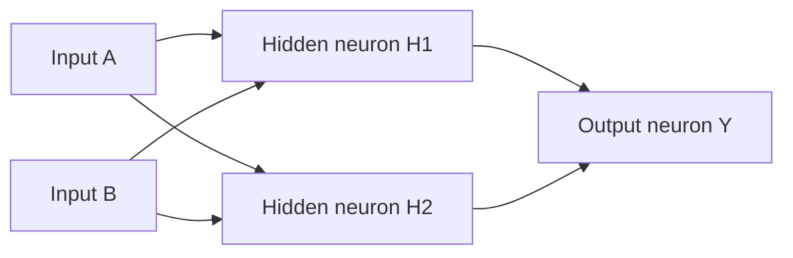
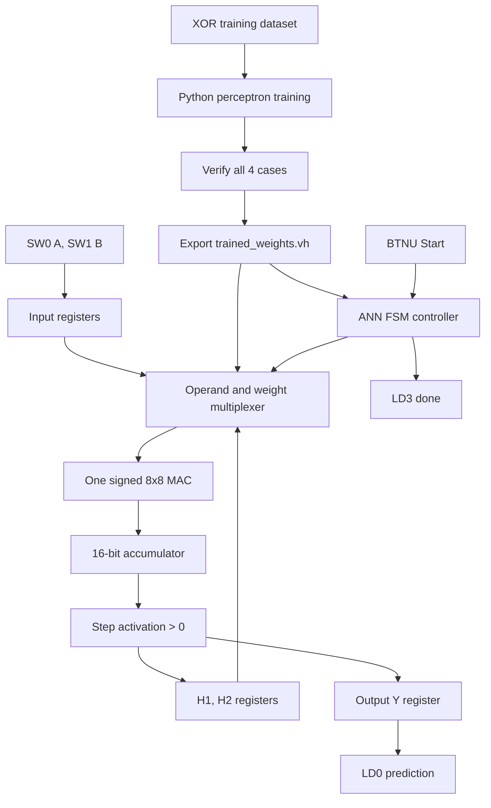

# Topic-13: AI-FPGA — Python-Trained XOR ANN with a Shared MAC Architecture

## Student Laboratory Template | System-Level FPGA Design

**Course:** 977-220 FPGA  
**Platform:** Nexys A7 (100 MHz)  
**Tools:** Python 3, AMD Vivado (XSim, synthesis, implementation), Verilog HDL  
**Student name:** ____________________ **ID:** ____________________  
**Group:** ____________________ **Date:** ____________________

> **Laboratory scope.** This lab revises the original *Topic-13: AI-FPGA — Artificial Neural Network for XOR Function*. It preserves the **2–2–1 ANN** and all four XOR cases, but replaces fixed, hand-selected combinational weights with **weights learned offline in Python** and replaces parallel weighted-sum logic with **one time-multiplexed MAC unit controlled by an FSM**. FPGA performs inference only.
>
> **Training limitation.** To make this introductory lab reproducible with integer-only hardware, Python trains three perceptrons separately using supervised intermediate targets: hidden neuron H1 learns OR, hidden neuron H2 learns NAND, and the output neuron learns AND(H1,H2). This is genuine supervised **neuron-wise perceptron training**, but **not end-to-end backpropagation**. End-to-end XOR training is an optional extension.

---

## 1. Learning outcomes

Students will be able to:

1. Explain why XOR requires nonlinear features or a hidden layer in a conventional perceptron network.
2. Train neuron weights and biases in Python and verify XOR classification on all four samples.
3. Export trained signed integer parameters into a Verilog header.
4. Implement a **shared multiply–accumulate (MAC) datapath** with an accumulator register.
5. Design an **FSM controller** that schedules the two hidden neurons and the output neuron.
6. Verify inference using a self-checking Verilog testbench.
7. Program the Nexys A7 and observe the prediction and intermediate neuron outputs.
8. Compare the area/latency trade-off between parallel ANN and time-multiplexed MAC designs.

## 2. Materials and starter files

| File | Purpose |
|---|---|
| `train_xor.py` | Python perceptron training and weight export |
| `trained_weights.vh` | Generated Verilog signed weight/bias parameters |
| `training_results.csv` | Python predictions for all XOR inputs |
| `mac_accum.v` | Shared signed MAC datapath |
| `xor_ann_mac_core.v` | FSM controller, input registers, activation, ANN top module |
| `tb_xor_ann_mac.v` | Self-checking exhaustive 4-case simulation |
| `xor_ann_mac_core_nexys_a7.xdc` | Clock, switches, buttons, LEDs |

**Requirements:** Python 3 (standard library only), Vivado, Nexys A7 and USB cable. No Python ML packages are required for this introductory training method.

## 3. Background: XOR and the 2–2–1 ANN

| A | B | Target Y = A XOR B |
|:---:|:---:|:---:|
| 0 | 0 | 0 |
| 0 | 1 | 1 |
| 1 | 0 | 1 |
| 1 | 1 | 0 |

Each neuron computes an integer weighted sum followed by a step activation:

\[
 z = w_0 x_0 + w_1 x_1 + b, \qquad
 f(z) = \begin{cases}1,&z>0,\\0,&z\le 0.\end{cases}
\]

The architecture is:



**Figure 1.** Logical 2–2–1 network. The **physical FPGA architecture below does not instantiate three separate MACs**; one MAC is reused across the neurons.

### Training targets

| A | B | H1 target = OR | H2 target = NAND | Y target = XOR |
|:---:|:---:|:---:|:---:|:---:|
| 0 | 0 | 0 | 1 | 0 |
| 0 | 1 | 1 | 1 | 1 |
| 1 | 0 | 1 | 1 | 1 |
| 1 | 1 | 1 | 0 | 0 |

The output perceptron learns `Y = AND(H1, H2)`, which reproduces XOR.

## 4. System-level design: Python → parameter export → FPGA



**Figure 2.** Proposed hardware/software co-design. The **MAC** is shared sequentially; weights are constants loaded during synthesis, not runtime updates from Python.

### MAC computation

The accumulator starts from the trained bias, then performs two sequential products:

\[
\begin{aligned}
\mathrm{ACC} &\leftarrow b,\\
\mathrm{ACC} &\leftarrow \mathrm{ACC} + w_0 x_0,\\
\mathrm{ACC} &\leftarrow \mathrm{ACC} + w_1 x_1,\\
 h &\leftarrow (\mathrm{ACC}>0).
\end{aligned}
\]

The three neurons are evaluated in this order: **H1 → H2 → Y**. Hidden outputs are stored before the output neuron runs.

### Controller schedule

| FSM state(s) | Action | MAC usage |
|---|---|---|
| `IDLE` | Wait for synchronized start; latch A and B | None |
| `LOAD_H1` | ACC ← bias(H1) | Load bias |
| `MAC_H1_A`, `MAC_H1_B` | ACC += A·w and B·w | 2 MAC cycles |
| `ACT_H1` | H1 ← (ACC > 0) | Threshold |
| `LOAD_H2` | ACC ← bias(H2) | Load bias |
| `MAC_H2_A`, `MAC_H2_B` | ACC += A·w and B·w | 2 MAC cycles |
| `ACT_H2` | H2 ← (ACC > 0) | Threshold |
| `LOAD_O` | ACC ← bias(output) | Load bias |
| `MAC_O_H1`, `MAC_O_H2` | ACC += H1·w and H2·w | 2 MAC cycles |
| `ACT_O` | Y ← (ACC > 0), assert done | Threshold |
| `DONE` | Return to idle | None |

**Timing:** From the accepted start event to `done`, the controller uses **12 active clock cycles** (3 bias loads + 6 MAC updates + 3 activations), plus input synchronization delay. At 100 MHz, 12 cycles correspond to 120 ns *nominal clock time*; actual hardware timing must be confirmed by Vivado. This design does not require a divided clock.

---

## 5. Task 1 — Train ANN weights in Python

**Procedure**

1. Open a terminal in the lab folder.
2. Run `python train_xor.py` (or `python3 train_xor.py`).
3. Inspect `trained_weights.vh` and `training_results.csv`.
4. Confirm that Python correctly predicts all four XOR input combinations.
5. Explain the perceptron learning rule:

\[
\hat y=f(\mathbf{w}\cdot\mathbf{x}+b),\quad
 e=t-\hat y,\quad
 \mathbf{w}\leftarrow\mathbf{w}+e\mathbf{x},\quad
 b\leftarrow b+e.
\]

The training script uses integer weights, learning rate 1, deterministic shuffling, and distinct seeds for H1, H2 and Y. Since the parameters are already integers, **no additional fixed-point quantization is required** in this version.

**Example output from the supplied script** (the precise values are generated, not entered by hand):

| Neuron | w0 | w1 | Bias | Epochs |
|---|---:|---:|---:|---:|
| H1 (OR) | 1 | 1 | 0 | 3 |
| H2 (NAND) | -1 | -2 | 3 | 7 |
| Y (AND) | 1 | 1 | -1 | 3 |

**Student training report**

| Neuron | Learned w0 | Learned w1 | Learned bias | Training epochs | All target cases correct? |
|---|---:|---:|---:|---:|---|
| H1 | | | | | |
| H2 | | | | | |
| Y | | | | | |

**Attach:** Python console screenshot and `trained_weights.vh` content.

**Question 1:** Why are the learned parameters suitable for signed integer arithmetic in Verilog?

Answer: ______________________________________________________________________

**Question 2:** How is this supervised neuron-wise training different from end-to-end backpropagation?

Answer: ______________________________________________________________________

## 6. Task 2 — Analyze the MAC datapath

Open `mac_accum.v` and identify:

- signed 8-bit input `x` and weight `w`;
- signed 8-bit bias input;
- signed 16-bit accumulator `acc`;
- `load_bias` and `mac_en` control signals;
- synchronous reset.

Complete the following calculation for input `A=0, B=1` using **your trained weights**.

| Neuron | ACC after bias load | After MAC #1 | After MAC #2 | Activation |
|---|---:|---:|---:|:---:|
| H1 | | | | |
| H2 | | | | |
| Y | | | | |

**Question 3:** Why must the accumulator be reloaded with a new bias before each neuron?

Answer: ______________________________________________________________________

**Question 4:** What is the difference between one shared MAC and three parallel MAC datapaths?

Answer: ______________________________________________________________________

## 7. Task 3 — Implement the FSM-based ANN controller

**Procedure**

1. Create a Vivado RTL project targeting the correct Nexys A7 board/device.
2. Add `mac_accum.v` and `xor_ann_mac_core.v` as design sources.
3. Add the generated `trained_weights.vh` as a Verilog header/include file; ensure Vivado can resolve the include path.
4. Set **`xor_ann_mac_core`** as the top module.
5. Open the RTL schematic and identify the accumulator, multiplier, operand multiplexer, state register, H1/H2 registers and Y register.

**Module interface**

```verilog
module xor_ann_mac_core (
    input  wire clk, rst, start, A, B,
    output reg  H1, H2, Y, done,
    output wire busy
);
```

**Student architecture checklist**

- [ ] One shared MAC instance is present in the RTL source.
- [ ] H1 and H2 are calculated sequentially.
- [ ] The output neuron uses registered H1 and H2.
- [ ] Input A and B are latched at the beginning of inference.
- [ ] The FSM asserts `done` only after Y is calculated.
- [ ] No synthesis or elaboration errors are reported.

**Attach:** RTL hierarchy and datapath screenshots.

## 8. Task 4 — Simulate all four XOR cases

**Procedure**

1. Add `tb_xor_ann_mac.v` as a simulation source.
2. Run **Behavioral Simulation** in Vivado XSim.
3. Observe `clk`, `rst`, `start`, `A`, `B`, `acc`, `state`, `H1`, `H2`, `Y`, and `done`.
4. Confirm the self-checking testbench prints `ALL 4 XOR CASES PASSED`.
5. Observe how the accumulator is reused across the three neurons.

**Expected classification**

| A | B | Expected H1 | Expected H2 | Expected Y | Observed Y | Pass / Fail |
|:---:|:---:|:---:|:---:|:---:|:---:|---|
| 0 | 0 | 0 | 1 | 0 | | |
| 0 | 1 | 1 | 1 | 1 | | |
| 1 | 0 | 1 | 1 | 1 | | |
| 1 | 1 | 1 | 0 | 0 | | |

**Attach:** XSim waveform screenshot, including the internal `acc` and `state` signals.

**Question 5:** Why does the output change after multiple clock cycles instead of immediately after switches change?

Answer: ______________________________________________________________________

## 9. Task 5 — Synthesize and analyze hardware resources

Run **Synthesis** and **Implementation**. Do not assume that a single RTL multiplication operator guarantees use of a DSP48E1 slice; Vivado may optimize this small binary-input design into LUT logic.

| Metric | MAC-based ANN result | Notes |
|---|---:|---|
| LUTs | | |
| Flip-flops | | |
| DSP48E1 slices | | |
| Block RAM | | |
| Worst negative slack (WNS) | | |
| Estimated power (if available) | | |
| Clock period constraint | 10 ns | 100 MHz |
| Cycles from accepted start to done | 12 | Controller schedule |

**Question 6:** Did Vivado infer a DSP slice? Explain why or why not using the synthesis report.

Answer: ______________________________________________________________________

**Question 7:** What hardware resources are added by the FSM compared with a combinational ANN?

Answer: ______________________________________________________________________

## 10. Task 6 — Nexys A7 implementation

**I/O assignments**

| Signal | Nexys A7 resource | FPGA pin | Purpose |
|---|---|---|---|
| `clk` | 100 MHz oscillator | E3 | System clock |
| `rst` | BTNC | N17 | Reset |
| `start` | BTNU | M18 | Start inference |
| `A` | SW0 | J15 | Input A |
| `B` | SW1 | L16 | Input B |
| `Y` | LD0 | H17 | ANN prediction |
| `H1` | LD1 | K15 | Hidden neuron 1 |
| `H2` | LD2 | J13 | Hidden neuron 2 |
| `done` | LD3 | N14 | Inference complete |

Use the provided `.xdc` and verify against the master XDC for your exact Nexys A7 variant.

**Hardware steps**

1. Generate the bitstream and program the Nexys A7.
2. Press BTNC to reset the circuit.
3. Set SW0 and SW1 to one input combination.
4. Press and release BTNU to start a new inference.
5. Observe LD0 (Y), LD1 (H1), LD2 (H2), and LD3 (done).
6. Repeat for all four combinations. The output is registered: **changing switches alone does not start inference**.

| SW1 (B) | SW0 (A) | Expected LD2 (H2) | Expected LD1 (H1) | Expected LD0 (Y) | Observed | Pass / Fail |
|:---:|:---:|:---:|:---:|:---:|---|---|
| 0 | 0 | 1 | 0 | 0 | | |
| 1 | 0 | 1 | 1 | 1 | | |
| 0 | 1 | 1 | 1 | 1 | | |
| 1 | 1 | 0 | 1 | 0 | | |

**Attach:** FPGA photographs for at least two different input cases.

**Note:** The start input is synchronized but **not debounced** in the starter design. For a robust extension, add a button debouncer or a one-shot event conditioner.

## 11. Task 7 — Compare the original ANN with the MAC-based ANN

The uploaded original lab used a combinational hidden layer and output neuron with manually supplied integer-scaled weights. This revision uses **Python-trained weights** and **sequential shared-MAC inference**.

| Property | Original combinational ANN | Revised shared-MAC ANN |
|---|---|---|
| Weights | Hand-selected constants | Trained and exported by Python |
| Computation | Combinational weighted sums | Sequential multiply–accumulate |
| Controller | Not required | FSM required |
| Accumulator | Not explicitly reused | One shared signed accumulator |
| Intermediate outputs | Combinational | Registered |
| Input handling | Switch changes propagate | Latch on start event |
| Latency | Combinational propagation | Multiple clock cycles |
| FPGA utilization | Record in Vivado | Record in Vivado |

**Question 8:** Which design would you choose for a larger neural network with limited multiplier resources? Justify your choice.

Answer: ______________________________________________________________________

## 12. Optional extension activities

- **Extension A — Parameter experiment:** Change training seeds, retrain, and verify the new generated weights in simulation.
- **Extension B — MAC reuse analysis:** Replace the shared MAC with one MAC per neuron; compare LUTs, registers, DSP slices, latency and WNS.
- **Extension C — Runtime weights:** Replace `localparam` constants with a small ROM or writable register bank. Explain the new weight-loading interface.
- **Extension D — End-to-end training:** Train the full 2–2–1 network in Python using backpropagation, then design an appropriate quantization and activation implementation. Verify all four XOR cases after quantization; do not assume the floating-point model's accuracy carries over automatically.
- **Extension E — Debounced start:** Add a button debouncer and demonstrate that one press produces one inference.

## 13. Laboratory report and submission checklist

**Abstract / objective (3–5 sentences):**

______________________________________________________________________________

**System architecture and training method:**

______________________________________________________________________________

**Python training results and learned parameters:**

______________________________________________________________________________

**MAC operation and FSM analysis:**

______________________________________________________________________________

**Simulation and hardware results:**

______________________________________________________________________________

**Resource and latency comparison:**

______________________________________________________________________________

**Conclusion:**

______________________________________________________________________________

**Submit:**

- [ ] Completed laboratory worksheet and all observation tables
- [ ] `train_xor.py`, `trained_weights.vh`, `training_results.csv`
- [ ] `mac_accum.v`, `xor_ann_mac_core.v`, `tb_xor_ann_mac.v`
- [ ] FPGA XDC file and Vivado project (or exported source archive)
- [ ] Python output screenshot
- [ ] XSim waveform and self-checking testbench output
- [ ] Vivado resource report and RTL screenshot
- [ ] FPGA verification photographs
- [ ] Answers to discussion questions and final conclusion

---

## References

1. Original teaching material: *Topic-13: AI-FPGA — Artificial Neural Network for XOR Function* (provided course material).
2. AMD, *Vivado Design Suite User Guide: Synthesis*.
3. Digilent, *Nexys A7 Reference Manual and Master XDC*.
4. S. Haykin, *Neural Networks and Learning Machines*, Pearson.

**Key concept:** `Python training → trained integer weights → Verilog parameter export → FSM-controlled shared MAC → threshold activation → FPGA XOR inference`.
