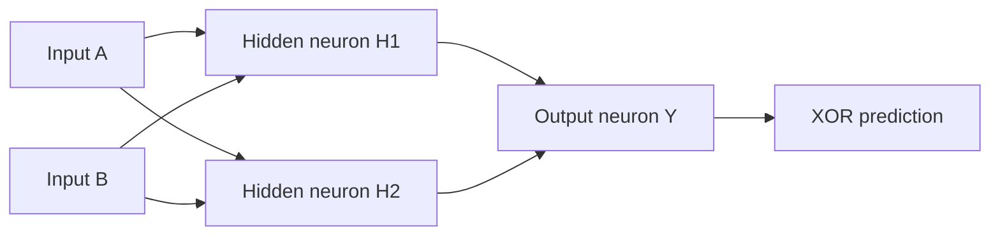
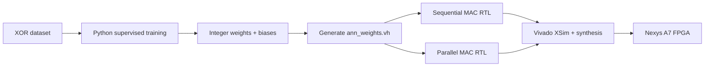
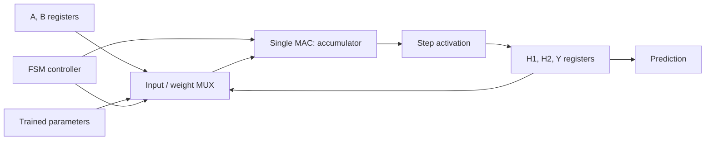
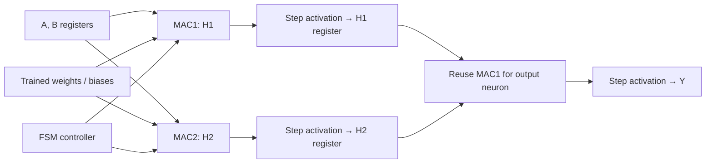

# Topic-13: AI-FPGA — Python-Trained XOR ANN Using Sequential and Parallel MAC Architectures

## Laboratory Worksheet and Report Template

**Course:** 977-220 FPGA  
**Board:** Nexys A7 (100 MHz clock)  
**Student name:** __________________________  **Student ID:** __________________________  
**Group:** __________________________  **Date:** __________________________

> **Instructions:** Complete every task and observation table. Attach Python training output, RTL diagrams, Vivado XSim waveforms, synthesis reports, and photographs of the FPGA demonstration. This laboratory trains the ANN **offline in Python** and performs **inference only on the FPGA**. Compare two RTL implementations using **exactly the same exported weights**.

---

## 1. Learning Objectives

After completing this laboratory, students should be able to:

1. Explain why XOR is not linearly separable by one perceptron.
2. Describe a **2-input → 2-hidden → 1-output (2–2–1)** ANN.
3. Train integer neuron weights and biases in Python, then export them to Verilog.
4. Explain a multiply–accumulate (MAC) datapath, bias initialization, and step activation.
5. Implement a **sequential/shared-MAC** ANN controlled by an FSM.
6. Implement a **layer-parallel/two-MAC** ANN with concurrent hidden-neuron calculations.
7. Verify all four XOR cases and measure cycle-level latency in Vivado XSim.
8. Synthesize **each architecture separately** for a meaningful FPGA resource comparison.
9. Deploy both architectures on the Nexys A7 and compare functional behavior.

## 2. Required Equipment and Project Files

- Nexys A7 FPGA board, USB cable, computer, AMD Vivado and XSim.
- Python 3 (standard library only; no external ML packages required).
- `python/train_xor.py` — supervised integer perceptron training and parameter export.
- `rtl/ann_weights.vh` — generated integer weights and biases.
- `rtl/mac_accum.v` — signed MAC datapath with accumulator register.
- `rtl/ann_mac_seq.v` — one-MAC sequential ANN inference controller.
- `rtl/ann_mac_parallel.v` — two-MAC layer-parallel inference controller.
- `rtl/ann_fpga_top.v` — parameter-selected FPGA wrapper.
- `sim/tb_ann_compare.v` — self-checking testbench for both designs.
- `constraints/nexys_a7.xdc` — Nexys A7 pin constraints.

## 3. Background: XOR and the 2–2–1 ANN

| A | B | Expected XOR (Y) |
|:---:|:---:|:---:|
| 0 | 0 | 0 |
| 0 | 1 | 1 |
| 1 | 0 | 1 |
| 1 | 1 | 0 |

A single linear threshold neuron cannot represent XOR. The two hidden neurons can implement **OR** and **NAND**, and the output neuron can implement **AND**, giving `XOR = OR AND NAND`.

**Figure 1.** Logical ANN topology (the topology is identical for both hardware architectures).

For each neuron, compute

\[
 z=w_1x_1+w_2x_2+b,\qquad
 f(z)=\begin{cases}1,&z>0\\0,&z\le 0.\end{cases}
\]

The **original Topic-13 material** used these manually selected integer-scaled equations:

\[
 z_1=2A+2B-1,\quad z_2=-2A-2B+3,\quad z_o=2H_1+2H_2-3.
\]

In this revised lab, **replace those fixed coefficients with parameters learned in Python**. Different correct weight sets may implement the same XOR truth table.

**Question:** Why does a hidden layer allow this network to classify XOR?  
**Answer:** __________________________________________________________________

## 4. System-Level Design: Python Training to FPGA Inference

**Figure 2.** Offline training and parameter export, followed by two alternative FPGA inference engines.

**Training methodology note:** The provided Python code uses *neuron-wise perceptron learning with supervised intermediate labels*: `H1 = OR(A,B)`, `H2 = NAND(A,B)`, and `Y = AND(H1,H2)`. It does **not** perform end-to-end backpropagation on an unconstrained multilayer network. The exercise is designed to make the learned integer parameters deterministic and directly usable in basic Verilog.

### Task 1 — Train the network in Python

1. Open a terminal in the extracted project directory.
2. Run `python python/train_xor.py` (or `python3 python/train_xor.py`).
3. Inspect `rtl/ann_weights.vh` and `training_results.csv`.
4. Confirm that every XOR prediction matches the expected output.
5. **Re-run the training script before simulation or synthesis** if you modify the training procedure.

The supplied deterministic training procedure currently produces:

| Neuron | Input 1 weight | Input 2 weight | Bias | Function |
|---|---:|---:|---:|---|
| H1 | 1 | 1 | 0 | OR |
| H2 | −2 | −1 | 3 | NAND |
| Y | 1 | 2 | −2 | AND of H1 and H2 |

Thus, for this run:

\[
H_1=f(A+B),\quad H_2=f(-2A-B+3),\quad Y=f(H_1+2H_2-2).
\]

**Student training observations:**

| Neuron | Learned w1 | Learned w2 | Learned bias | Epochs to convergence |
|---|---:|---:|---:|---:|
| H1 | | | | |
| H2 | | | | |
| Y | | | | |

**Attach:** Python console output and generated parameter file.  
**Figure 3.** [Insert training output screenshot here]

## 5. Task 2 — Manual ANN and MAC Calculation

For each input, calculate the learned weighted sums and step activations.

| A | B | z1 | H1 | z2 | H2 | zo | Y | Expected XOR | Match? |
|:---:|:---:|:---:|:---:|:---:|:---:|:---:|:---:|:---:|:---:|
| 0 | 0 | | | | | | | 0 | |
| 0 | 1 | | | | | | | 1 | |
| 1 | 0 | | | | | | | 1 | |
| 1 | 1 | | | | | | | 0 | |

The MAC recurrence is

\[
 s\leftarrow s+w\times x,
\]

with **bias initialization** `s ← b` before accumulating each neuron's two weighted inputs. After both products are accumulated, apply `f(s)` and store the neuron output.

**Worked example:** Input (A,B)=(____,____)  
H1: `s=b1 → s+w11*A → s+w12*B` = __________________________  
H2: `s=b2 → s+w21*A → s+w22*B` = __________________________  
Y: `s=bo → s+wo1*H1 → s+wo2*H2` = __________________________

## 6. Architecture A — Sequential ANN with One Shared MAC

One MAC datapath is **time-multiplexed** across H1, H2, and Y. An FSM selects the weight, input, and bias; each neuron uses two multiply–accumulate updates.

**Figure 4.** Shared-MAC architecture. The controller processes H1, then H2, then Y.

### Scheduled operations

| FSM states | Operation | Destination |
|---|---|---|
| H1_INIT, H1_A, H1_B, H1_SAVE | Initialize bias, accumulate two products, activate | H1 |
| H2_INIT, H2_A, H2_B, H2_SAVE | Initialize bias, accumulate two products, activate | H2 |
| Y_INIT, Y_H1, Y_H2, Y_SAVE | Initialize bias, accumulate two products, activate | Y |

**Expected RTL latency:** **12 clock cycles** from acceptance of `start` to assertion of `done` for this implementation. It performs six product-accumulation updates, plus bias initialization and result-register states. This is a property of the **provided FSM**, not a universal MAC latency.

### Task 3 — Implement sequential RTL

Add `mac_accum.v`, `ann_mac_seq.v`, and the generated `ann_weights.vh` to Vivado. Inspect the state transitions and signed arithmetic.

- [ ] The MAC accumulator loads the bias when `clear=1`.
- [ ] The MAC adds a signed product when `enable=1`.
- [ ] H1 and H2 are stored before the output-neuron computation.
- [ ] The output is valid only when `done=1`.
- [ ] The core ignores new `start` requests while `busy=1`.

**Attach:** RTL hierarchy screenshot.  
**Figure 5.** [Insert sequential architecture RTL screenshot here]

## 7. Architecture B — Layer-Parallel ANN with Two MAC Units

Two MAC units operate **concurrently** for the hidden layer: MAC1 computes H1 and MAC2 computes H2. Once both are stored, MAC1 is **reused** to compute Y. This is **layer-parallel**, not a fully parallel implementation with all six multiplications at once.

**Figure 6.** Two-MAC layer-parallel architecture. H1 and H2 share the same time slots; Y is computed afterward.

### Scheduled operations

| FSM states | MAC1 | MAC2 |
|---|---|---|
| H_INIT | Load b1 | Load b2 |
| H_A | Add w11·A | Add w21·A |
| H_B | Add w12·B | Add w22·B |
| H_SAVE | Store H1 | Store H2 |
| Y_INIT | Load bo | Idle |
| Y_H1 | Add wo1·H1 | Idle |
| Y_H2 | Add wo2·H2 | Idle |
| Y_SAVE | Store Y | Idle |

**Expected RTL latency:** **8 clock cycles** from acceptance of `start` to `done` for the provided parallel controller. Both architectures still perform six mathematical product terms, but the parallel controller schedules some concurrently.

### Task 4 — Implement parallel RTL

Add `ann_mac_parallel.v` to the same Vivado project and inspect how the FSM drives the two MAC datapaths.

- [ ] H1 and H2 are computed concurrently.
- [ ] MAC1 is reused for the output neuron after H1/H2 are ready.
- [ ] The exact same `ann_weights.vh` is used as for the sequential core.
- [ ] Both cores produce the same outputs for all four inputs.

**Attach:** RTL hierarchy screenshot.  
**Figure 7.** [Insert parallel architecture RTL screenshot here]

## 8. Task 5 — Vivado XSim: Functional and Latency Verification

1. Add both core RTL files and `mac_accum.v` to **Design Sources**.
2. Add `sim/tb_ann_compare.v` to **Simulation Sources**.
3. Add the `rtl` directory to Vivado's **Verilog include search paths** so that `ann_weights.vh` resolves.
4. Select `tb_ann_compare` as the **simulation top** and run Behavioral Simulation.
5. Observe `start`, `busy`, `done`, `H1`, `H2`, `Y`, and the FSM state for each core.
6. The testbench checks four XOR cases and reports the cycle counts. A failure terminates with `$fatal`.

| A | B | Expected Y | Sequential Y | Parallel Y | Seq. cycles | Par. cycles | Pass / Fail |
|:---:|:---:|:---:|:---:|:---:|---:|---:|:---:|
| 0 | 0 | 0 | | | | | |
| 0 | 1 | 1 | | | | | |
| 1 | 0 | 1 | | | | | |
| 1 | 1 | 0 | | | | | |

**Expected values for the supplied RTL:** 12 cycles sequential; 8 cycles parallel. Actual waveforms must be checked in XSim. At 100 MHz (10 ns per clock), these correspond to nominal **120 ns** and **80 ns** from accepted start to done, respectively. These are controller-cycle latencies, not measured post-route timing.

**Attach:** Waveforms showing simultaneous hidden-layer computation in the parallel architecture.  
**Figure 8.** [Insert sequential and parallel XSim waveforms here]

**Simulation observations:** ___________________________________________________

## 9. Task 6 — FPGA Synthesis and Resource Comparison

**Important:** Do **not** synthesize a top module that instantiates both cores and report that as either architecture's resource usage.

The provided `ann_fpga_top` has a compile-time parameter `PARALLEL`:

- `PARALLEL=0`: synthesize **only** the sequential core.
- `PARALLEL=1`: synthesize **only** the layer-parallel core.

Create two synthesis runs (or two project configurations), keeping the same device, constraints, tool version, and weights. Select `ann_fpga_top` as synthesis top and set its parameter override accordingly.

| FPGA metric | Sequential MAC | Parallel MAC | Difference / observation |
|---|---:|---:|---|
| LUTs | | | |
| Flip-flops | | | |
| DSP48 slices | | | |
| Block RAM | | | |
| WNS / timing slack | | | |
| Estimated power (if reported) | | | |
| Clock cycles per inference | | | |
| Nominal latency at 100 MHz | | | |

**Important:** Because the inputs are binary and the trained weights are small constants, Vivado may optimize `weight * x` into muxes and adders. **Do not assume** the number of DSP slices equals the number of RTL MAC modules. Use the actual synthesis report.

**Attach:** Utilization and timing screenshots for both synthesis runs.  
**Figure 9.** [Insert sequential utilization report here]  
**Figure 10.** [Insert parallel utilization report here]

## 10. Task 7 — Nexys A7 Hardware Implementation

Use the included `constraints/nexys_a7.xdc` and the `ann_fpga_top` wrapper.

| Signal | Nexys A7 resource | Purpose |
|---|---|---|
| `clk` | 100 MHz oscillator | System clock |
| `rst` | BTNC | Synchronous reset |
| `start_button` | BTNU | Start inference |
| `A` | SW0 | ANN input A |
| `B` | SW1 | ANN input B |
| `Y` | LD0 | Prediction |
| `H1` | LD1 | Hidden neuron H1 |
| `H2` | LD2 | Hidden neuron H2 |
| `busy` | LD3 | Inference in progress |

**Procedure:** Set SW0 and SW1, press BTNU, then inspect LD0–LD2. Repeat for each of the four input combinations. Program the sequential bitstream and the parallel bitstream **separately**. The wrapper synchronizes the start button and detects a rising edge; it does not include a full mechanical-button debouncer. The `busy` pulse is only 8–12 clocks long and will generally be too brief to see on an LED; use simulation or an on-chip logic analyzer to inspect it.

| A | B | Expected Y | Seq. LD0 | Par. LD0 | H1 / H2 observed | Pass / Fail |
|:---:|:---:|:---:|:---:|:---:|---|:---:|
| 0 | 0 | 0 | | | | |
| 0 | 1 | 1 | | | | |
| 1 | 0 | 1 | | | | |
| 1 | 1 | 0 | | | | |

**Attach:** FPGA photographs or instructor verification for each architecture.  
**Figure 11.** [Insert Nexys A7 hardware photographs here]

## 11. Task 8 — Comparative System-Level Analysis

| Characteristic | Sequential shared MAC | Layer-parallel two MACs |
|---|---|---|
| MAC datapaths in RTL | 1 | 2 |
| Hidden neurons | Sequential | Concurrent |
| Output neuron | Same shared MAC | Reuses MAC1 |
| Mathematical product terms | 6 | 6 |
| Product-update clock slots | 6 | 4 |
| Controller latency in supplied RTL | 12 cycles | 8 cycles |
| FPGA LUT / FF / DSP usage | Measure | Measure |
| Relative resource cost | To be determined | To be determined |
| Relative throughput | To be determined | To be determined |

**Questions:**

1. Why can the two hidden neurons be computed simultaneously?  
   Answer: ______________________________________________________________
2. Why must the output neuron wait for both hidden-neuron activations?  
   Answer: ______________________________________________________________
3. Does having two RTL MAC modules guarantee twice as many DSP slices? Explain.  
   Answer: ______________________________________________________________
4. What is the cycle-level speedup of the supplied parallel controller?  
   Calculation: ________________________  Result: ________________________
5. Which architecture is more resource-efficient according to **your** Vivado report?  
   Answer: ______________________________________________________________
6. Why are Python training and FPGA inference separated?  
   Answer: ______________________________________________________________

## 12. Task 9 — ANN-Based XOR Versus Direct XOR

A direct logic implementation is `assign Y = A ^ B;`. Compare it with the two ANN inference engines.

| Aspect | Direct XOR | Sequential ANN | Parallel ANN |
|---|---|---|---|
| Trained weights required? | No | Yes | Yes |
| Hidden neurons? | No | Yes | Yes |
| FSM required? | No | Yes | Yes |
| Inference latency | Combinational | | |
| Resource usage (if synthesized) | | | |
| Educational purpose | Boolean logic | MAC reuse / control | Parallel datapaths |

**Question:** Why is the ANN more useful as a hardware-architecture teaching example than as a replacement for an XOR gate?  
**Answer:** ______________________________________________________________

## 13. Optional Extensions (Choose One)

- [ ] Train a 2–2–1 network end-to-end using backpropagation, quantize its weights, and check whether XOR accuracy survives quantization.
- [ ] Implement a fully parallel architecture with two products computed simultaneously **within each neuron**, and compare its latency/resources.
- [ ] Add a weight ROM instead of compile-time Verilog parameters.
- [ ] Add a debouncer and a visible `done` indicator on the Nexys A7.
- [ ] Compare 8-bit versus 4-bit weight representations and measure synthesis utilization.
- [ ] Add an automated simulation test that checks intermediate weighted sums, not only output Y.

**Selected extension:** ______________________________________________________

**Method / results:** ________________________________________________________

## 14. Conclusion

Summarize (a) Python training, (b) correct XOR inference, (c) sequential and parallel MAC scheduling, (d) measured FPGA resources, and (e) observed latency.

______________________________________________________________________________

______________________________________________________________________________

______________________________________________________________________________

## 15. Submission Checklist

- [ ] Completed Python training log and exported `ann_weights.vh`
- [ ] Completed manual calculation table
- [ ] Sequential MAC RTL and FSM screenshot
- [ ] Parallel MAC RTL and FSM screenshot
- [ ] Self-checking XSim testbench with all four XOR cases passing
- [ ] Measured cycle counts for both architectures
- [ ] Separate Vivado synthesis and timing reports
- [ ] Nexys A7 demonstration of both architectures
- [ ] Comparison, discussion answers, and conclusion

**Student signature:** __________________________ **Date:** __________________

---

### Reference and Implementation Notes

This worksheet revises the uploaded **Topic-13: AI-FPGA — Artificial Neural Network for XOR Function** laboratory template. It retains the XOR truth table, 2–2–1 ANN, signed integer arithmetic, Vivado XSim verification, Nexys A7 switches/LEDs, utilization analysis, and student-report structure. The new Python-trained weights and two FSM/MAC implementations are additions for this comparative lab.

**Verification status:** The included Python training script was executed successfully and verified all four XOR cases. The provided RTL and self-checking testbench are intended for Vivado XSim; their cycle counts are predicted from the FSM schedules and should be confirmed by simulation. No actual Vivado synthesis, timing, or hardware measurements are claimed in this template.
