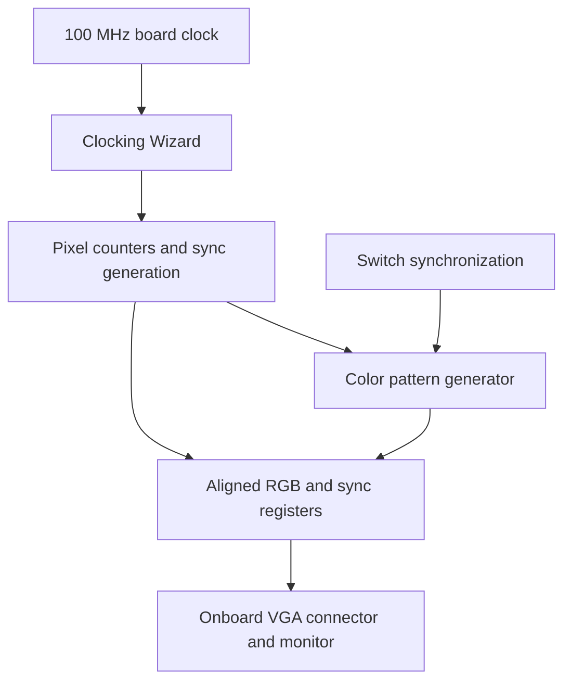

# Project Topic: Simple Color Display via VGA on Nexys A7

## 1. Project Description

Design an FPGA display controller that generates color patterns on a VGA monitor using the Nexys A7's onboard VGA connector. Students will implement raster timing, RGB generation, switch-based pattern selection, and hardware verification.

This introductory graphics project uses SystemVerilog and Vivado. It requires no processor, Vitis application, external RAM, or framebuffer: colors are computed directly from the current pixel position.

## 2. Learning Objectives

- Explain pixel clocks, horizontal/vertical synchronization, and blanking.
- Generate a 640 × 480 raster using counters.
- Drive the board's four-bit red, green, and blue signals.
- Use a Clocking Wizard IP to derive a pixel clock from the onboard oscillator.
- Display switch-selected solid colors and geometric patterns.
- Verify timing and blanking in simulation before programming the FPGA.

## 3. Equipment

| Item | Purpose |
| --- | --- |
| Nexys A7-100T | Target board for the supplied constraints |
| Vivado Design Suite | Design, simulation, and implementation |
| USB programming cable | Bitstream download and board power, as supported |
| VGA cable | Connect board to display |
| Monitor with VGA input | View generated image |

Select the exact FPGA part or board preset. A Nexys A7-50T requires its own board selection and verified constraints. A passive VGA-to-HDMI cable does not convert the analog video signal; use a VGA monitor or a suitable active VGA-input converter if necessary.

## 4. Display Features and Controls

| SW3–SW2 | Display mode | SW1–SW0 |
| --- | --- | --- |
| `00` | Solid color | `00`: red; `01`: green; `10`: blue; `11`: white |
| `01` | Eight vertical color bars | Ignored |
| `10` | Four colored quadrants | Ignored |
| `11` | Centered yellow rectangle on dark blue | Ignored |

Press and release **BTNC** to restart the raster counters. Brief display resynchronization during reset is expected. Keep switches steady while observing each pattern.

## 5. VGA and Color Representation

The Nexys A7 provides four FPGA-driven bits per color through an onboard resistor network, plus horizontal and vertical sync signals. The 12-bit RGB interface supports 4,096 digital color combinations. Use the existing VGA connector; the resistor network handles the analog color-level conversion.

Pack colors as `{red[3:0], green[3:0], blue[3:0]}`:

| Color | Hex RGB |
| --- | --- |
| Black | `12'h000` |
| Red | `12'hF00` |
| Green | `12'h0F0` |
| Blue | `12'h00F` |
| White | `12'hFFF` |
| Yellow | `12'hFF0` |
| Cyan | `12'h0FF` |
| Magenta | `12'hF0F` |
| Dark blue | `12'h008` |

These are digital channel codes, not calibrated luminance or colorimetric measurements.

## 6. Raster Timing

Use the following 640 × 480 raster structure. The coordinate origin is the first active pixel of the first active line.

| Interval | Horizontal, pixel clocks | Vertical, lines |
| --- | ---: | ---: |
| Active display | 640 | 480 |
| Front porch | 16 | 10 |
| Negative sync pulse | 96 | 2 |
| Back porch | 48 | 33 |
| Total | 800 | 525 |

The counter ranges and sync conditions are:

- Horizontal count: 0–799; active when less than 640.
- Vertical count: 0–524; active when less than 480.
- HS is low for horizontal counts 656–751.
- VS is low for vertical counts 490–491.
- RGB is zero outside the active display region, including all porches.

Request a **25.200 MHz pixel clock** in Clocking Wizard. With these totals:

$$
f_{\mathrm{line}}=25{,}200{,}000/800=31{,}500\ \mathrm{Hz},
$$

$$
f_{\mathrm{frame}}=25{,}200{,}000/(800\times525)=60.000\ \mathrm{Hz}.
$$

This project uses a nominal 60 Hz timing variant. The commonly specified 25.175 MHz clock with the same totals gives approximately 59.94 Hz. Check the generated clock frequency and monitor compatibility; if a monitor requires 25.175 MHz, request that frequency and retain the same raster counts. Do not describe a simple 100 MHz divide-by-four clock as exactly 60 Hz: at 25 MHz these totals give approximately 59.52 Hz.

## 7. Architecture



RGB and both sync signals are registered together, introducing the same one-pixel delay to every output. This preserves their alignment.

## 8. Project Files

Create these files using the code below:

| File or IP | Source type | Role |
| --- | --- | --- |
| `vga_color_core.sv` | Design source | Raster timing and color patterns |
| `vga_color_top.sv` | Design source | Clock IP, reset, and switch synchronization |
| `vga_nexys_a7_100t.xdc` | Constraints | Pin and input-clock assignments |
| `tb_vga_color_core.sv` | Simulation source | Raster, color, and blanking checks |
| `clk_wiz_vga` | Generated Clocking Wizard IP | Pixel clock |

The Clocking Wizard is generated in Vivado rather than supplied as handwritten RTL.

## 9. VGA Core: `vga_color_core.sv`

```systemverilog
module vga_color_core (
    input  logic       pixel_clk,
    input  logic       rst,
    input  logic [3:0] control,
    output logic [3:0] VGA_R, VGA_G, VGA_B,
    output logic       VGA_HS, VGA_VS
);
    logic [9:0] x, y;
    logic [11:0] rgb;
    logic active_video;

    always_comb begin
        active_video = (x < 640) && (y < 480);
        rgb = 12'h000;

        if (active_video) begin
            case (control[3:2])
                2'b00: begin
                    case (control[1:0])
                        2'b00: rgb = 12'hF00;
                        2'b01: rgb = 12'h0F0;
                        2'b10: rgb = 12'h00F;
                        2'b11: rgb = 12'hFFF;
                    endcase
                end
                2'b01: begin
                    if      (x < 80)  rgb = 12'hFFF;
                    else if (x < 160) rgb = 12'hFF0;
                    else if (x < 240) rgb = 12'h0FF;
                    else if (x < 320) rgb = 12'h0F0;
                    else if (x < 400) rgb = 12'hF0F;
                    else if (x < 480) rgb = 12'hF00;
                    else if (x < 560) rgb = 12'h00F;
                    else              rgb = 12'h000;
                end
                2'b10: begin
                    if (y < 240)
                        rgb = (x < 320) ? 12'hF00 : 12'h0F0;
                    else
                        rgb = (x < 320) ? 12'h00F : 12'hFFF;
                end
                2'b11: begin
                    if ((x >= 160) && (x < 480) &&
                        (y >= 120) && (y < 360))
                        rgb = 12'hFF0;
                    else
                        rgb = 12'h008;
                end
            endcase
        end
    end

    always_ff @(posedge pixel_clk) begin
        if (rst) begin
            x <= 0;
            y <= 0;
            VGA_R <= 0;
            VGA_G <= 0;
            VGA_B <= 0;
            VGA_HS <= 1'b1;
            VGA_VS <= 1'b1;
        end else begin
            // All outputs use the same pre-edge pixel coordinates.
            {VGA_R, VGA_G, VGA_B} <= rgb;
            VGA_HS <= !((x >= 656) && (x < 752));
            VGA_VS <= !((y >= 490) && (y < 492));

            if (x == 799) begin
                x <= 0;
                if (y == 524) y <= 0;
                else          y <= y + 1'b1;
            end else begin
                x <= x + 1'b1;
            end
        end
    end
endmodule
```

During reset, colors are black and sync outputs are inactive. Normal raster timing resumes after reset is released.

## 10. Top Module: `vga_color_top.sv`

```systemverilog
module vga_color_top (
    input  wire       CLK100MHZ,
    input  wire       BTNC,
    input  wire [3:0] SW,
    output wire [3:0] VGA_R, VGA_G, VGA_B,
    output wire       VGA_HS, VGA_VS
);
    wire pixel_clk, locked;
    wire reset_request = BTNC | ~locked;

    (* ASYNC_REG = "TRUE" *) logic [1:0] reset_pipe = 2'b11;
    (* ASYNC_REG = "TRUE" *) logic [3:0] sw_meta = 4'b0;
    (* ASYNC_REG = "TRUE" *) logic [3:0] sw_sync = 4'b0;

    // Generate this exact IP name and port configuration in Vivado.
    clk_wiz_vga CLOCK_IP (
        .clk_in1(CLK100MHZ),
        .reset(1'b0),
        .clk_out1(pixel_clk),
        .locked(locked)
    );

    // Asynchronous assertion, pixel-clock-synchronous release.
    always_ff @(posedge pixel_clk or posedge reset_request) begin
        if (reset_request) reset_pipe <= 2'b11;
        else               reset_pipe <= {reset_pipe[0], 1'b0};
    end

    always_ff @(posedge pixel_clk) begin
        if (reset_pipe[1]) begin
            sw_meta <= 0;
            sw_sync <= 0;
        end else begin
            sw_meta <= SW;
            sw_sync <= sw_meta;
        end
    end

    vga_color_core DISPLAY (
        .pixel_clk(pixel_clk), .rst(reset_pipe[1]), .control(sw_sync),
        .VGA_R(VGA_R), .VGA_G(VGA_G), .VGA_B(VGA_B),
        .VGA_HS(VGA_HS), .VGA_VS(VGA_VS)
    );
endmodule
```

The initialization values are intended for Vivado FPGA synthesis. Per-bit switch synchronization is appropriate for steady manual controls, but does not guarantee atomic updates of a changing four-bit setting. A brief intermediate pattern or a mid-frame change can occur when switches move. A frame-boundary control latch is an optional improvement.

## 11. Create the Pixel Clock IP

1. Create an RTL project named `nexys_a7_vga_color` and select the exact Nexys A7-100T board or device.
2. Add the two SystemVerilog design files.
3. Open IP Catalog and add **Clocking Wizard**.
4. Name the instance **`clk_wiz_vga`**.
5. Configure a single-ended 100.000 MHz primary input.
6. Enable one output, `clk_out1`, and request 25.200 MHz.
7. Enable `locked` and an active-high `reset` input. Leave optional dynamic reconfiguration, clock-enable, and extra ports disabled for this example.
8. Generate output products and inspect the generated instantiation template. Its ports must match the top module.
9. Check the actual generated output frequency and that the clock uses the IP's clock-management and global-buffer resources.

Do not replace the generated IP with an unresolved black box or create the pixel clock using an ordinary fabric counter output. If your Wizard generates different port names, update the instantiation consistently.

## 12. Nexys A7-100T Constraints

Save as `vga_nexys_a7_100t.xdc`. These assignments follow Digilent's Nexys A7-100T master XDC. Verify the board variant before use. Port names must match `vga_color_top` exactly.

```tcl
set_property -dict {PACKAGE_PIN E3 IOSTANDARD LVCMOS33} [get_ports CLK100MHZ]
create_clock -name sys_clk -period 10.000 [get_ports CLK100MHZ]

set_property -dict {PACKAGE_PIN N17 IOSTANDARD LVCMOS33} [get_ports BTNC]
set_property -dict {PACKAGE_PIN J15 IOSTANDARD LVCMOS33} [get_ports {SW[0]}]
set_property -dict {PACKAGE_PIN L16 IOSTANDARD LVCMOS33} [get_ports {SW[1]}]
set_property -dict {PACKAGE_PIN M13 IOSTANDARD LVCMOS33} [get_ports {SW[2]}]
set_property -dict {PACKAGE_PIN R15 IOSTANDARD LVCMOS33} [get_ports {SW[3]}]

set_property -dict {PACKAGE_PIN A3 IOSTANDARD LVCMOS33} [get_ports {VGA_R[0]}]
set_property -dict {PACKAGE_PIN B4 IOSTANDARD LVCMOS33} [get_ports {VGA_R[1]}]
set_property -dict {PACKAGE_PIN C5 IOSTANDARD LVCMOS33} [get_ports {VGA_R[2]}]
set_property -dict {PACKAGE_PIN A4 IOSTANDARD LVCMOS33} [get_ports {VGA_R[3]}]
set_property -dict {PACKAGE_PIN C6 IOSTANDARD LVCMOS33} [get_ports {VGA_G[0]}]
set_property -dict {PACKAGE_PIN A5 IOSTANDARD LVCMOS33} [get_ports {VGA_G[1]}]
set_property -dict {PACKAGE_PIN B6 IOSTANDARD LVCMOS33} [get_ports {VGA_G[2]}]
set_property -dict {PACKAGE_PIN A6 IOSTANDARD LVCMOS33} [get_ports {VGA_G[3]}]
set_property -dict {PACKAGE_PIN B7 IOSTANDARD LVCMOS33} [get_ports {VGA_B[0]}]
set_property -dict {PACKAGE_PIN C7 IOSTANDARD LVCMOS33} [get_ports {VGA_B[1]}]
set_property -dict {PACKAGE_PIN D7 IOSTANDARD LVCMOS33} [get_ports {VGA_B[2]}]
set_property -dict {PACKAGE_PIN D8 IOSTANDARD LVCMOS33} [get_ports {VGA_B[3]}]
set_property -dict {PACKAGE_PIN B11 IOSTANDARD LVCMOS33} [get_ports VGA_HS]
set_property -dict {PACKAGE_PIN B12 IOSTANDARD LVCMOS33} [get_ports VGA_VS]
```

Keep the Clocking Wizard's generated constraints enabled. Do not add a second unrelated primary clock definition on its output. Inspect generated clocks, clock-domain crossings, and timing reports. The switch/button inputs are asynchronous controls; constrain synchronization entry paths appropriately without suppressing internal pixel-domain timing checks. VGA is an analog display interface without a forwarded pixel-clock pin; document any external-output timing assumptions rather than assigning arbitrary synchronous I/O delays.

## 13. Self-Checking Testbench

Save as `tb_vga_color_core.sv`. Simulate the core directly so this test does not depend on Clocking Wizard simulation models. All eight control settings used below cover the four solid colors and all pattern modes.

```systemverilog
`timescale 1ns/1ps
module tb_vga_color_core;
    logic clk = 0;
    always #19.841 clk = ~clk; // Approximately 25.2 MHz.
    logic rst = 1;
    logic [3:0] control = 0;
    wire [3:0] r, g, b;
    wire hs, vs;
    integer setting, px, line;
    integer active_count, hs_low_count, vs_low_count;
    logic [11:0] expected;
    logic [3:0] settings[0:7];

    vga_color_core DUT (
        .pixel_clk(clk), .rst(rst), .control(control),
        .VGA_R(r), .VGA_G(g), .VGA_B(b), .VGA_HS(hs), .VGA_VS(vs)
    );

    function automatic logic [11:0] reference_color(
        input integer x, y, input logic [3:0] c
    );
        logic [11:0] palette[0:7];
        begin
            palette[0]=12'hFFF; palette[1]=12'hFF0;
            palette[2]=12'h0FF; palette[3]=12'h0F0;
            palette[4]=12'hF0F; palette[5]=12'hF00;
            palette[6]=12'h00F; palette[7]=12'h000;
            if (x >= 640 || y >= 480) reference_color = 12'h000;
            else case (c[3:2])
                0: case (c[1:0])
                    0: reference_color=12'hF00;
                    1: reference_color=12'h0F0;
                    2: reference_color=12'h00F;
                    3: reference_color=12'hFFF;
                endcase
                1: reference_color=palette[x/80];
                2: case ((y/240)*2 + x/320)
                    0: reference_color=12'hF00;
                    1: reference_color=12'h0F0;
                    2: reference_color=12'h00F;
                    3: reference_color=12'hFFF;
                endcase
                3: reference_color=((x>=160 && x<480) &&
                                    (y>=120 && y<360)) ? 12'hFF0 : 12'h008;
            endcase
        end
    endfunction

    initial begin
        settings[0]=4'h0; settings[1]=4'h1;
        settings[2]=4'h2; settings[3]=4'h3;
        settings[4]=4'h4; settings[5]=4'h8;
        settings[6]=4'hC; settings[7]=4'hF;
        repeat (3) @(negedge clk);

        for (setting=0; setting<8; setting=setting+1) begin
            // Hold reset for an edge, then start from pixel (0,0).
            rst = 1;
            control = settings[setting];
            @(negedge clk);
            rst = 0;
            active_count=0; hs_low_count=0; vs_low_count=0;

            for (line=0; line<525; line=line+1) begin
                for (px=0; px<800; px=px+1) begin
                    expected=reference_color(px,line,control);
                    @(posedge clk);
                    #1; // Registered outputs correspond to pre-edge coordinates.
                    if ({r,g,b} !== expected)
                        $fatal(1,"RGB mismatch x=%0d y=%0d mode=%h",px,line,control);
                    if (hs !== !((px>=656)&&(px<752)))
                        $fatal(1,"HS mismatch");
                    if (vs !== !((line>=490)&&(line<492)))
                        $fatal(1,"VS mismatch");
                    if (px<640 && line<480) active_count=active_count+1;
                    if (!hs) hs_low_count=hs_low_count+1;
                    if (!vs) vs_low_count=vs_low_count+1;
                end
            end

            if (active_count!=307200 || hs_low_count!=50400 || vs_low_count!=1600)
                $fatal(1,"Frame count mismatch");
            if (DUT.x !== 10'd0 || DUT.y !== 10'd0)
                $fatal(1,"Frame counters did not wrap");
            $display("PASS: control=%h, full raster checked",control);
            @(negedge clk);
        end
        $display("PASS: all display settings checked");
        $finish;
    end
endmodule
```

Select `tb_vga_color_core` as the simulation top and use **Run All**. Eight complete frames require approximately 134 ms of simulated time, so the default short simulation interval is insufficient. Limit waveform logging to selected signals or a short time window to avoid large waveform files. Testing the top-level clock/reset IP is a separate integration check.

## 14. Implementation Steps

1. Add the RTL and XDC, and generate Clocking Wizard output products.
2. Set `vga_color_top` as the synthesis top.
3. Run core behavioral simulation and resolve any failures.
4. Open the elaborated schematic and identify clocking, counters, switch synchronizers, pattern logic, and output registers.
5. Run synthesis and implementation. Check timing, generated pixel frequency, and constraints warnings.
6. Generate the bitstream and program the board through Hardware Manager.
7. Connect the VGA cable, select the monitor's VGA input, and release reset.
8. Test every solid color and all pattern modes. Record monitor model and whether it locks reliably.

No image should be claimed as experimentally demonstrated until observed on hardware.

## 15. Project Experiments

| Test | Switch setting | Expected display | Observation | Pass/Fail |
| --- | --- | --- | --- | --- |
| Solid red | `0000` | Red active area | | |
| Solid green | `0001` | Green active area | | |
| Solid blue | `0010` | Blue active area | | |
| Solid white | `0011` | White active area | | |
| Color bars | `0100` | Eight equal-width vertical bars | | |
| Quadrants | `1000` | Red/green upper, blue/white lower | | |
| Rectangle | `1100` | Centered 320 × 240 yellow rectangle | | |
| Reset | Press/release BTNC | Display restarts and monitor relocks | | |

If measurement equipment is available, record HS period, HS low width, VS period, and VS low width. Expected values at 25.2 MHz are approximately 31.746 microseconds, 3.810 microseconds, 16.667 milliseconds, and 63.492 microseconds, respectively. These are calculated targets, not measured results.

## 16. Troubleshooting

| Symptom | Check |
| --- | --- |
| No signal | Correct monitor input, generated pixel clock, IP locked, reset released, HS/VS pins |
| Unsupported mode | Actual pixel frequency, 800 × 525 totals, sync polarity, monitor compatibility |
| Wrong colors | RGB pin order and four-bit channel mapping |
| Image shifted or unstable | Porch counts, counter wrap, aligned registered RGB/sync |
| Colored retrace area | RGB must be zero throughout blanking |
| Clock IP unresolved | Exact IP name, ports, and generated output products |
| Simulation appears frozen | Run long enough; each frame is 420,000 pixel clocks |
| Pattern flashes when switches change | Multi-bit control transition; optionally latch settings at frame boundaries |

## 17. Suggested Assessment

| Criterion | Marks |
| --- | ---: |
| VGA timing and clock/reset design | 25 |
| Working solid colors and patterns | 25 |
| Simulation evidence and debugging | 20 |
| Correct constraints and implementation reports | 15 |
| Demonstration and explanation | 15 |
| Total | 100 |

## 18. Extensions

- Latch synchronized control values only at a frame boundary.
- Change rectangle position using buttons with debounced event detection.
- Add a frame-based motion counter for a bouncing rectangle.
- Implement gradients using scaled pixel coordinates.
- Display text using a small character ROM.
- Visualize an ANN class, MAC result, sensor reading, or DCM coding-state matrix.

When adding ROMs or arithmetic pipelines, delay synchronization and blanking by the same number of pixel cycles as the new RGB path.

## 19. Deliverables

- RTL modules, generated Clocking Wizard configuration, testbench, and XDC.
- Timing-table explanation and architecture screenshot.
- Simulation pass messages and representative waveforms.
- Photos or video of each display mode.
- Resource utilization, timing report, and actual generated clock frequency.
- A short discussion of blanking, synchronization, color encoding, and one extension.

## 20. References

1. Digilent, [Nexys A7 Reference Manual, VGA Port and VGA System Timing](https://digilent.com/reference/_media/reference/programmable-logic/nexys-a7/nexys-a7_rm.pdf).
2. Digilent, [Nexys A7-100T Master XDC](https://github.com/Digilent/digilent-xdc/blob/master/Nexys-A7-100T-Master.xdc).
3. AMD, [Clocking Wizard Product Guide (PG065)](https://docs.amd.com/r/en-US/pg065-clk-wiz).
4. AMD, [Vivado Logic Simulation User Guide (UG900)](https://docs.amd.com/r/en-US/ug900-vivado-logic-simulation).

**Project outcome:** A standalone FPGA graphics controller that displays selectable colors and geometric patterns through the Nexys A7 VGA connector.
