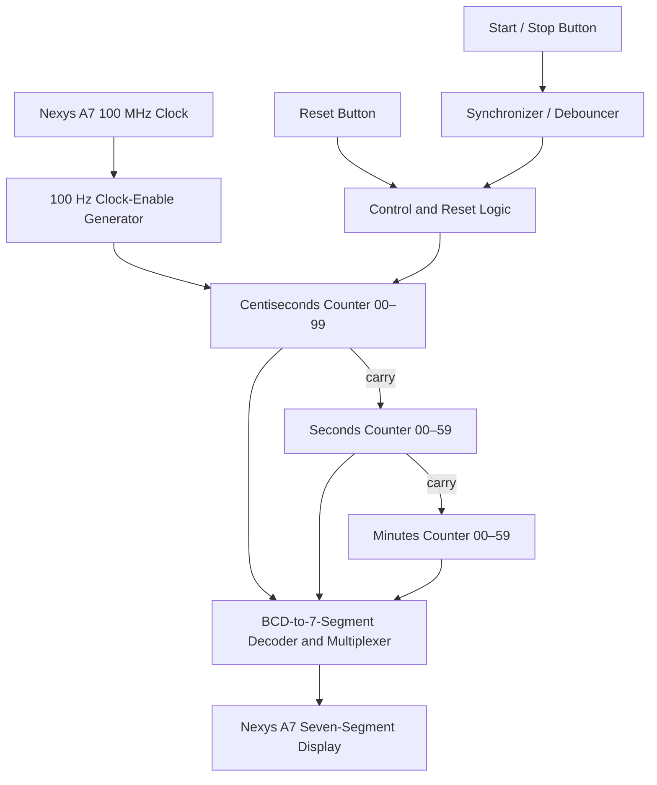
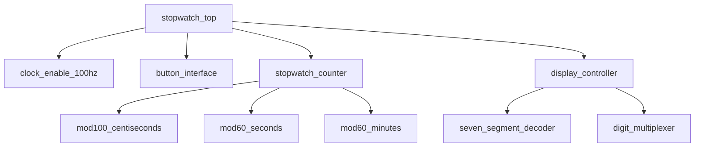
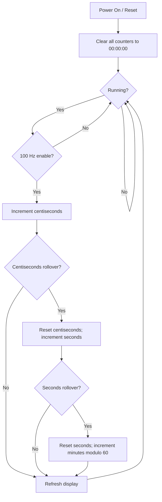

# Pre-Project: System-Level Design of a Digital Stopwatch Using Nexys A7 FPGA

**Platform:** Nexys A7 FPGA  
**Language:** Verilog HDL  
**Tool:** AMD Vivado  
**Project type:** Hierarchical system-level design

## 1. Introduction

This pre-project develops a digital stopwatch using reusable hardware modules. The stopwatch counts centiseconds, seconds, and minutes and illustrates how a clock source, clock-enable generator, cascaded counters, and display subsystem are integrated through a top-level module.

**Source basis:** The uploaded *Expected Result Pattern for Stopwatch* uses a 10 ms simulation clock period, reset asserted for the first 20 ms, and an initial count at 25 ms. Those values describe its testbench, **not** the 100 MHz FPGA oscillator. The source also shows an unusual rollover (`00:01:99` followed by `00:01:00`); this pre-project instead specifies conventional rollover (`00:00:99` followed by `00:01:00`).

## 2. Learning Objectives

1. Partition a digital system into hierarchical Verilog modules.
2. Derive a 100 Hz clock-enable pulse from the Nexys A7 100 MHz clock.
3. Implement cascaded BCD or modulo counters for `mm:ss:cs`.
4. Design synchronous reset and start/stop control.
5. Integrate counters with a multiplexed seven-segment display.
6. Verify operation on a physical FPGA and document expected results.

## 3. Functional Specification

| Requirement | Proposed specification |
|---|---|
| Input clock | 100 MHz onboard oscillator |
| Stopwatch tick | 100 Hz enable pulse, one tick per 10 ms |
| Display | `mm:ss:cs`, six decimal digits |
| Centiseconds | 00–99, roll over to seconds |
| Seconds | 00–59, roll over to minutes |
| Minutes | 00–59, roll over to 00 |
| Controls | Reset, Start/Stop (proposed extensions beyond source) |
| Reset behavior | Display `00:00:00` |
| Run behavior | Increment one centisecond per 100 Hz enable when running |

> **Scope note:** The uploaded file documents the stopwatch testbench pattern only. The display, start/stop input, FPGA pin mapping, and modulo-60 seconds/minutes are proposed system-level design requirements rather than properties verified by that source.

## 4. System Architecture (Mermaid)



## 5. Module Hierarchy



| Module | Main responsibility |
|---|---|
| `clock_enable_100hz` | Generate a one-cycle 100 Hz enable pulse |
| `button_interface` | Synchronize/debounce physical buttons |
| `stopwatch_counter` | Coordinate cascaded centisecond, second, minute counting |
| `mod100_centiseconds` | Count 00–99 and issue carry |
| `mod60_seconds` | Count 00–59 and issue carry |
| `mod60_minutes` | Count 00–59 and wrap |
| `seven_segment_decoder` | Convert BCD digits to segment patterns |
| `digit_multiplexer` | Refresh selected display digits |
| `stopwatch_top` | Integrate all components |

## 6. System-Level Control Flow



## 7. Suggested Top-Level Interface

```verilog
module stopwatch_top (
    input  wire clk,          // 100 MHz FPGA clock
    input  wire rst,          // active-high reset
    input  wire start_stop,   // push-button control
    output wire [6:0] seg,   // seven-segment outputs
    output wire dp,          // decimal point
    output wire [7:0] an     // digit enables
);
    // Instantiate clock-enable, button interface,
    // cascaded counters, and display controller.
endmodule
```

The interface is a **design template**, not complete synthesizable implementation. Students must supply the modules and use the official Nexys A7 master XDC for the exact physical pin assignments.

## 8. Expected Counting Pattern

| Tick after reset | Expected `mm:ss:cs` |
|---:|---|
| 0 | 00:00:00 |
| 1 | 00:00:01 |
| 2 | 00:00:02 |
| 9 | 00:00:09 |
| 10 | 00:00:10 |
| 98 | 00:00:98 |
| 99 | 00:00:99 |
| 100 | 00:01:00 |
| 6,000 | 01:00:00 |

At 100 Hz, tick 100 occurs after one second of accumulated running time. The exact wall-clock timestamp of the first tick depends on reset release, clock-enable phase, and start/stop behavior.

### Uploaded Testbench Reference (for comparison only)

The uploaded document specifies `timescale 1ms/1us`, a clock toggle every 5 ms, reset from 0 to 20 ms, and a first post-reset rising edge at 25 ms. Its expected console trace starts at `25 | 00:00:01`. These are **simulation-specific observations**, not hardware timings to apply directly to the FPGA.

## 9. FPGA Implementation Procedure

1. Create a Vivado RTL project for the Nexys A7 device.
2. Implement the clock-enable and counter modules individually.
3. Integrate modules through `stopwatch_top`.
4. Implement display scanning and seven-segment decoding.
5. Add XDC constraints for the clock, buttons, and display using the official board master XDC.
6. Run synthesis, implementation, and bitstream generation.
7. Program the Nexys A7 and verify reset, run, pause, and rollovers.

**Hardware design rule:** Keep all state registers clocked by the 100 MHz oscillator; use `tick_100hz` as an enable rather than routing a fabric-generated clock to the counters.

## 10. FPGA Verification Checklist

- [ ] Reset clears the display to `00:00:00`.
- [ ] Start initiates counting; Stop freezes the displayed value.
- [ ] Centiseconds increment every 10 ms while running.
- [ ] `00:00:99` advances to `00:01:00`.
- [ ] `00:59:99` advances to `01:00:00`.
- [ ] Display digits remain stable and legible during multiplexing.
- [ ] No repeated toggles occur from a single push-button press.

## 11. Required Deliverables

- System-level architecture and control-flow diagrams (Mermaid).
- Module hierarchy and interface description.
- Verilog source files and top-level module.
- XDC constraints and Vivado project.
- Physical FPGA demonstration and a brief verification table.

---

**Extension:** After completing the stopwatch, students may reuse the clock-enable, button-interface, and FSM design principles in the traffic-light controller with pedestrian crossing.
