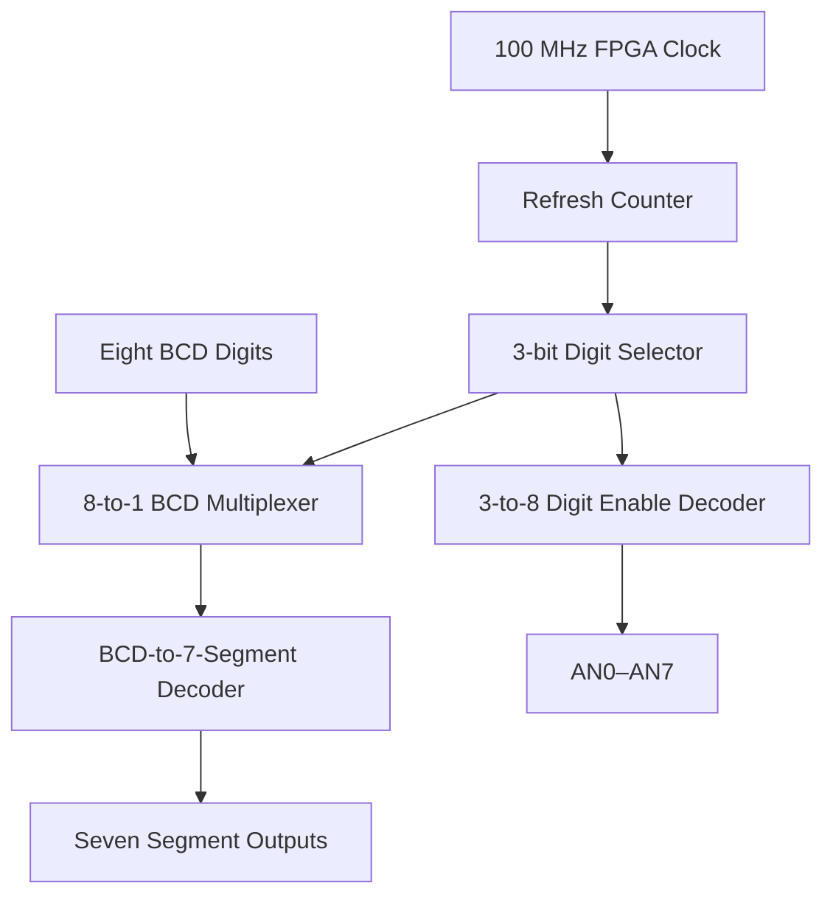

# Verilog: BCD-to-7-Segment Decoder and Multiplexer

**Target board:** Nexys A7 FPGA  
**Language:** Verilog HDL  
**Clock:** 100 MHz  
**Display:** Eight-digit, active-low seven-segment display

This design uses two Verilog modules:

1. **BCD-to-7-Segment Decoder:** Converts a 4-bit BCD value (0–9) into seven-segment outputs.
2. **7-Segment Multiplexer:** Selects one of eight BCD digits and displays them using time-division multiplexing.

The Nexys A7 seven-segment display uses **active-low signals** for segments and digit enables.

## 1. BCD-to-7-Segment Decoder

```verilog
module bcd_to_7seg (
    input  wire [3:0] bcd,
    output reg  [6:0] seg
);
    // seg = {g, f, e, d, c, b, a}
    // Active-low outputs
    always @(*) begin
        case (bcd)
            4'd0: seg = 7'b1000000;
            4'd1: seg = 7'b1111001;
            4'd2: seg = 7'b0100100;
            4'd3: seg = 7'b0110000;
            4'd4: seg = 7'b0011001;
            4'd5: seg = 7'b0010010;
            4'd6: seg = 7'b0000010;
            4'd7: seg = 7'b1111000;
            4'd8: seg = 7'b0000000;
            4'd9: seg = 7'b0010000;
            default: seg = 7'b1111111;
        endcase
    end
endmodule
```

### Expected decoder outputs

| BCD | Digit | `seg[6:0]` |
|---|---|---|
| 0000 | 0 | 1000000 |
| 0001 | 1 | 1111001 |
| 0010 | 2 | 0100100 |
| 0011 | 3 | 0110000 |
| 0100 | 4 | 0011001 |
| 0101 | 5 | 0010010 |
| 0110 | 6 | 0000010 |
| 0111 | 7 | 1111000 |
| 1000 | 8 | 0000000 |
| 1001 | 9 | 0010000 |

## 2. Eight-Digit 7-Segment Multiplexer

The 100 MHz clock scans each digit for approximately **1 ms**, resulting in a full-display refresh rate of **125 Hz**.

```verilog
module seven_seg_mux (
    input  wire clk,
    input  wire rst,
    input  wire [3:0] digit0,
    input  wire [3:0] digit1,
    input  wire [3:0] digit2,
    input  wire [3:0] digit3,
    input  wire [3:0] digit4,
    input  wire [3:0] digit5,
    input  wire [3:0] digit6,
    input  wire [3:0] digit7,
    output wire [6:0] seg,
    output wire dp,
    output reg  [7:0] an
);
    // 100 MHz / 100,000 = 1 kHz digit switching
    reg [16:0] refresh_count;
    reg [2:0] digit_select;
    reg [3:0] selected_bcd;

    always @(posedge clk) begin
        if (rst) begin
            refresh_count <= 0;
            digit_select  <= 0;
        end
        else if (refresh_count == 17'd99_999) begin
            refresh_count <= 0;
            digit_select  <= digit_select + 1'b1;
        end
        else begin
            refresh_count <= refresh_count + 1'b1;
        end
    end

    // Select BCD digit
    always @(*) begin
        case (digit_select)
            3'd0: selected_bcd = digit0;
            3'd1: selected_bcd = digit1;
            3'd2: selected_bcd = digit2;
            3'd3: selected_bcd = digit3;
            3'd4: selected_bcd = digit4;
            3'd5: selected_bcd = digit5;
            3'd6: selected_bcd = digit6;
            3'd7: selected_bcd = digit7;
            default: selected_bcd = 4'd0;
        endcase
    end

    // Active-low digit enables
    always @(*) begin
        an = ~(8'b00000001 << digit_select);
    end

    bcd_to_7seg u_decoder (
        .bcd(selected_bcd),
        .seg(seg)
    );

    // Decimal point OFF
    assign dp = 1'b1;
endmodule
```

## 3. System-Level Architecture



## 4. Example Top-Level Module

The following example displays **12345678** across the eight-digit display.

```verilog
module display_top (
    input  wire clk,
    input  wire rst,
    output wire [6:0] seg,
    output wire dp,
    output wire [7:0] an
);
    seven_seg_mux u_display (
        .clk(clk),
        .rst(rst),
        .digit0(4'd8),
        .digit1(4'd7),
        .digit2(4'd6),
        .digit3(4'd5),
        .digit4(4'd4),
        .digit5(4'd3),
        .digit6(4'd2),
        .digit7(4'd1),
        .seg(seg),
        .dp(dp),
        .an(an)
    );
endmodule
```

## 5. Integration with the Stopwatch

| Digit | Stopwatch data |
|---|---|
| `digit0` | Centiseconds units |
| `digit1` | Centiseconds tens |
| `digit2` | Seconds units |
| `digit3` | Seconds tens |
| `digit4` | Minutes units |
| `digit5` | Minutes tens |
| `digit6` | Reserved |
| `digit7` | Reserved |

The display can show `00MMSSCC`, with the two unused digits set to zero.

**Implementation note:** The display refresh counter is independent of the stopwatch's 100 Hz clock-enable generator, allowing the seven-segment display to refresh continuously while the stopwatch counts, pauses, or resets.
