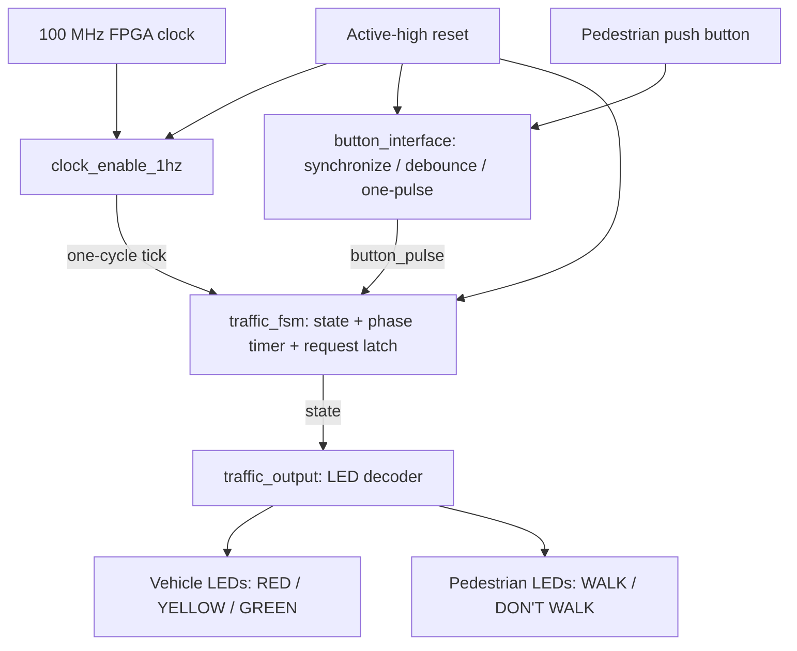
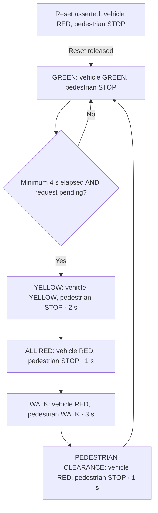

# Pre-Project: System-Level Design of a Single-Road Traffic Light with Pedestrian Crossing

**Platform:** Nexys A7 FPGA · **HDL:** Verilog-2001 · **Tool:** AMD Vivado · **Verification:** Physical FPGA demonstration (no simulation required)

## 1. Project overview

Design one vehicle traffic signal (**RED, YELLOW, GREEN**) and one pedestrian signal (**WALK, DON'T WALK**) with a push-button crossing request. The controller normally holds vehicle GREEN. Once a pedestrian request is registered and a minimum GREEN interval has elapsed, the FSM executes YELLOW → ALL RED → WALK → PEDESTRIAN CLEARANCE → GREEN. The vehicle must never show GREEN during WALK.

This is a preparatory project for a later two-road East–West / North–South intersection controller.

## 2. Learning outcomes

- Decompose a system into reusable, hierarchical Verilog modules.
- Implement a finite state machine (FSM) and state-dependent timing.
- Derive a **1 Hz clock-enable pulse** from the Nexys A7 **100 MHz** clock without introducing a second clock domain.
- Synchronize and debounce a pedestrian button, detect a new press, and retain a pending request.
- Build and demonstrate the system on physical FPGA hardware.

## 3. System-level architecture (Mermaid)



**Design rule:** All registers use `posedge clk` at 100 MHz. The `tick_1hz` signal is a one-cycle **enable**, not a generated clock. The `button_interface` output is a one-cycle pulse, and the FSM stores the request until it can safely serve it.

## 4. System concept and FSM flowchart (Mermaid)



A button press is accepted during GREEN. A held button creates only one request; release and press again for another request. Requests made during other states are ignored in this introductory implementation.

## 5. Inputs and outputs

| Signal | Direction | Description |
|---|---|---|
| `clk` | Input | Nexys A7 onboard 100 MHz clock |
| `rst` | Input | Active-high reset |
| `ped_button` | Input | Active-high pedestrian request button |
| `red`, `yellow`, `green` | Output | Vehicle signal LEDs |
| `ped_walk`, `ped_stop` | Output | Pedestrian signal LEDs |

### FSM timing and output specification

| State | Vehicle | Pedestrian | Duration / exit |
|---|---|---|---|
| `S_RESET` | RED | STOP | Until reset is released; next 100 MHz edge enters GREEN |
| `S_GREEN` | GREEN | STOP | At least 4 one-second ticks; wait for request |
| `S_YELLOW` | YELLOW | STOP | 2 one-second ticks |
| `S_ALL_RED` | RED | STOP | 1 one-second tick |
| `S_WALK` | RED | WALK | 3 one-second ticks |
| `S_PED_CLEAR` | RED | STOP | 1 one-second tick |

The time values are illustrative lab settings. GREEN may remain active indefinitely without a pedestrian request. Because button events are asynchronous to the one-second tick, the response time depends on when the request arrives.

## 6. Complete hierarchical Verilog code

Create **five separate `.v` source files** with the names below and add them to the Vivado project. Select `traffic_top` as the top module.

### 6.1 `clock_enable_1hz.v`

```verilog
module clock_enable_1hz #(
    parameter integer CLK_HZ = 100_000_000
)(
    input  wire clk,
    input  wire rst,
    output reg  tick_1hz
);
    reg [31:0] count;

    always @(posedge clk) begin
        if (rst) begin
            count    <= 32'd0;
            tick_1hz <= 1'b0;
        end else if (count == CLK_HZ - 1) begin
            count    <= 32'd0;
            tick_1hz <= 1'b1;
        end else begin
            count    <= count + 1'b1;
            tick_1hz <= 1'b0;
        end
    end
endmodule
```

The output `tick_1hz` is high for **one 100 MHz cycle** every second.

### 6.2 `button_interface.v`

```verilog
module button_interface #(
    parameter integer DEBOUNCE_CYCLES = 2_000_000 // 20 ms @ 100 MHz
)(
    input  wire clk,
    input  wire rst,
    input  wire button_in,
    output reg  button_pulse
);
    reg sync_1, sync_2;
    reg stable_button;
    reg [31:0] debounce_count;

    // Two flip-flops synchronize the asynchronous push button.
    always @(posedge clk) begin
        if (rst) begin
            sync_1 <= 1'b0;
            sync_2 <= 1'b0;
        end else begin
            sync_1 <= button_in;
            sync_2 <= sync_1;
        end
    end

    // A new press is reported only after the input is stable.
    always @(posedge clk) begin
        if (rst) begin
            stable_button  <= 1'b0;
            debounce_count <= 32'd0;
            button_pulse   <= 1'b0;
        end else begin
            button_pulse <= 1'b0;
            if (sync_2 == stable_button) begin
                debounce_count <= 32'd0;
            end else if (debounce_count == DEBOUNCE_CYCLES - 1) begin
                stable_button  <= sync_2;
                debounce_count <= 32'd0;
                if (sync_2)
                    button_pulse <= 1'b1; // Rising edge only
            end else begin
                debounce_count <= debounce_count + 1'b1;
            end
        end
    end
endmodule
```

### 6.3 `traffic_fsm.v`

```verilog
module traffic_fsm #(
    parameter integer GREEN_MIN_S = 4,
    parameter integer YELLOW_S    = 2,
    parameter integer ALL_RED_S   = 1,
    parameter integer WALK_S      = 3,
    parameter integer CLEAR_S     = 1
)(
    input  wire clk,
    input  wire rst,
    input  wire tick_1hz,
    input  wire button_pulse,
    output reg  [2:0] state
);
    localparam [2:0]
        S_RESET     = 3'd0,
        S_GREEN     = 3'd1,
        S_YELLOW    = 3'd2,
        S_ALL_RED   = 3'd3,
        S_WALK      = 3'd4,
        S_PED_CLEAR = 3'd5;

    reg [31:0] elapsed_s;
    reg request_pending;

    always @(posedge clk) begin
        if (rst) begin
            state           <= S_RESET;
            elapsed_s       <= 32'd0;
            request_pending <= 1'b0;
        end else begin
            // Exit the safe reset state after reset release.
            if (state == S_RESET) begin
                state           <= S_GREEN;
                elapsed_s       <= 32'd0;
                request_pending <= 1'b0;
            end else begin
                // Capture a debounced new press during GREEN.
                if (state == S_GREEN && button_pulse)
                    request_pending <= 1'b1;

                if (tick_1hz) begin
                    case (state)
                        S_GREEN: begin
                            // Saturate elapsed time once the minimum is met.
                            if (elapsed_s < GREEN_MIN_S)
                                elapsed_s <= elapsed_s + 1'b1;

                            if ((elapsed_s >= GREEN_MIN_S - 1) &&
                                (request_pending || button_pulse)) begin
                                state           <= S_YELLOW;
                                elapsed_s       <= 32'd0;
                                request_pending <= 1'b0;
                            end
                        end
                        S_YELLOW: begin
                            if (elapsed_s >= YELLOW_S - 1) begin
                                state     <= S_ALL_RED;
                                elapsed_s <= 32'd0;
                            end else
                                elapsed_s <= elapsed_s + 1'b1;
                        end
                        S_ALL_RED: begin
                            if (elapsed_s >= ALL_RED_S - 1) begin
                                state     <= S_WALK;
                                elapsed_s <= 32'd0;
                            end else
                                elapsed_s <= elapsed_s + 1'b1;
                        end
                        S_WALK: begin
                            if (elapsed_s >= WALK_S - 1) begin
                                state     <= S_PED_CLEAR;
                                elapsed_s <= 32'd0;
                            end else
                                elapsed_s <= elapsed_s + 1'b1;
                        end
                        S_PED_CLEAR: begin
                            if (elapsed_s >= CLEAR_S - 1) begin
                                state     <= S_GREEN;
                                elapsed_s <= 32'd0;
                            end else
                                elapsed_s <= elapsed_s + 1'b1;
                        end
                        default: begin
                            state           <= S_RESET;
                            elapsed_s       <= 32'd0;
                            request_pending <= 1'b0;
                        end
                    endcase
                end
            end
        end
    end
endmodule
```

**Timing detail:** The GREEN transition is evaluated on a 1 Hz tick. If a button press arrives after the minimum GREEN interval, the next tick starts YELLOW. A request arriving earlier is latched until the minimum interval completes.

### 6.4 `traffic_output.v`

```verilog
module traffic_output (
    input  wire [2:0] state,
    output reg  red,
    output reg  yellow,
    output reg  green,
    output reg  ped_walk,
    output reg  ped_stop
);
    localparam [2:0]
        S_RESET     = 3'd0,
        S_GREEN     = 3'd1,
        S_YELLOW    = 3'd2,
        S_ALL_RED   = 3'd3,
        S_WALK      = 3'd4,
        S_PED_CLEAR = 3'd5;

    always @(*) begin
        // Safe defaults also cover illegal/unknown state encodings.
        red      = 1'b1;
        yellow   = 1'b0;
        green    = 1'b0;
        ped_walk = 1'b0;
        ped_stop = 1'b1;

        case (state)
            S_GREEN: begin
                red   = 1'b0;
                green = 1'b1;
            end
            S_YELLOW: begin
                red    = 1'b0;
                yellow = 1'b1;
            end
            S_WALK: begin
                ped_walk = 1'b1;
                ped_stop = 1'b0;
            end
            default: begin
                // RESET, ALL_RED, and PED_CLEAR use safe defaults.
            end
        endcase
    end
endmodule
```

### 6.5 `traffic_top.v`

```verilog
module traffic_top (
    input  wire clk,
    input  wire rst,
    input  wire ped_button,
    output wire red,
    output wire yellow,
    output wire green,
    output wire ped_walk,
    output wire ped_stop
);
    wire tick_1hz;
    wire button_pulse;
    wire [2:0] state;

    clock_enable_1hz #(
        .CLK_HZ(100_000_000)
    ) u_clock_enable (
        .clk(clk), .rst(rst), .tick_1hz(tick_1hz)
    );

    button_interface #(
        .DEBOUNCE_CYCLES(2_000_000)
    ) u_button (
        .clk(clk), .rst(rst),
        .button_in(ped_button), .button_pulse(button_pulse)
    );

    traffic_fsm #(
        .GREEN_MIN_S(4),
        .YELLOW_S(2),
        .ALL_RED_S(1),
        .WALK_S(3),
        .CLEAR_S(1)
    ) u_fsm (
        .clk(clk), .rst(rst), .tick_1hz(tick_1hz),
        .button_pulse(button_pulse), .state(state)
    );

    traffic_output u_output (
        .state(state), .red(red), .yellow(yellow),
        .green(green), .ped_walk(ped_walk), .ped_stop(ped_stop)
    );
endmodule
```

## 7. FPGA implementation in Vivado (no simulation)

1. Create an RTL project targeting the **correct Nexys A7 board variant**.
2. Add all five `.v` files; set `traffic_top` as the top module.
3. Open the **official Digilent Nexys A7 master XDC** matching the board variant. Uncomment and rename the clock, two buttons, and five LED assignments to match the top-level ports. Verify the board's button polarity and LED pin mapping; do not guess pin numbers.
4. Set the onboard clock period to **10 ns** (100 MHz) in the XDC.
5. Run **Synthesis → Implementation → Generate Bitstream** and review timing and implementation messages.
6. Program the board; press reset and observe the initial safe RED state, then GREEN.
7. Press and release the pedestrian button; observe YELLOW, ALL RED, WALK, clearance, and return to GREEN.
8. Verify that holding the button does not repeatedly request crossings, and that WALK never coincides with GREEN.

**Hardware timing note:** A 1-second FSM tick is an enable pulse derived from the 100 MHz oscillator; it is not a clock that physically toggles every 0.5 seconds. The initial 1-second tick occurs approximately one second after reset is released.

## 8. Expected physical FPGA results

| Condition | Vehicle LED | Pedestrian LED | Expected observation |
|---|---|---|---|
| Reset held | RED | STOP | Safe state |
| Reset released, no request | GREEN | STOP | Normal flow |
| Button pressed during GREEN | GREEN initially | STOP | Request stored, no immediate WALK |
| Request served | YELLOW | STOP | 2 s warning |
| After YELLOW | RED | STOP | 1 s all-red interval |
| Pedestrian phase | RED | WALK | 3 s crossing |
| Clearance | RED | STOP | 1 s clearance |
| Return to normal | GREEN | STOP | Wait for next new press |

### Safety invariants

- `green && ped_walk` must **always be false**.
- `ped_walk` implies `red`.
- Exactly one vehicle light should be on in every defined state.
- A continuous held button produces only one request event.


## 9. Extension to Mini-Project II

Reuse the button interface, clock-enable generator, and output-decoding approach to implement **two intersecting roads**, East–West and North–South, each with separate RED/YELLOW/GREEN signals. Add an all-red interlock before switching vehicle directions and before enabling pedestrian WALK.
